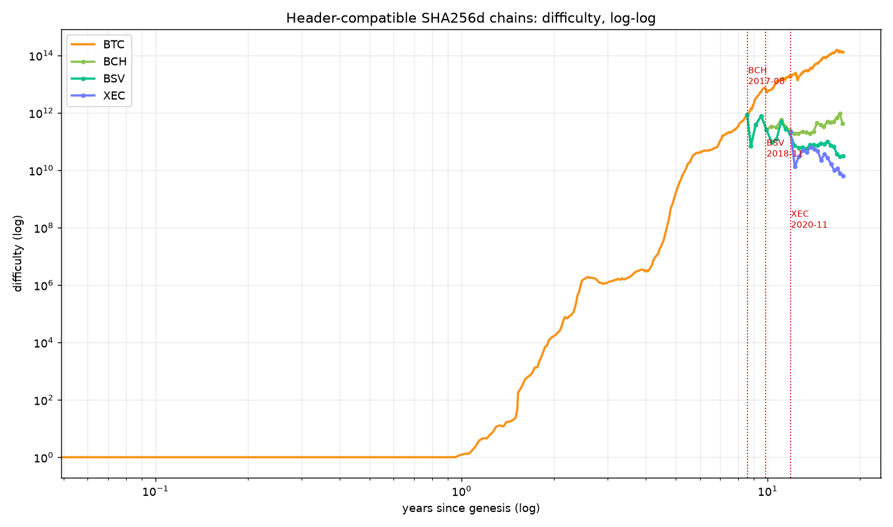
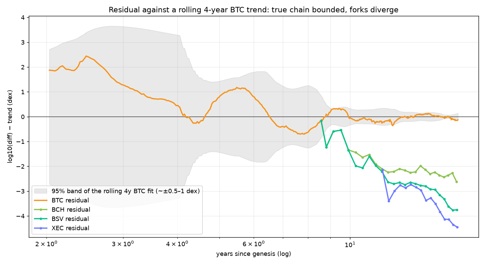
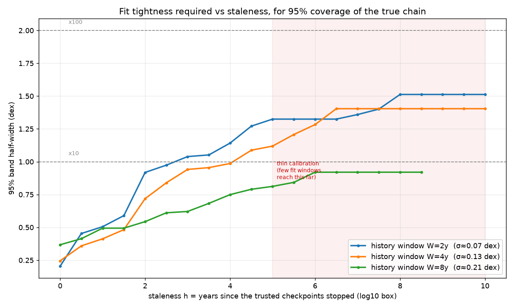
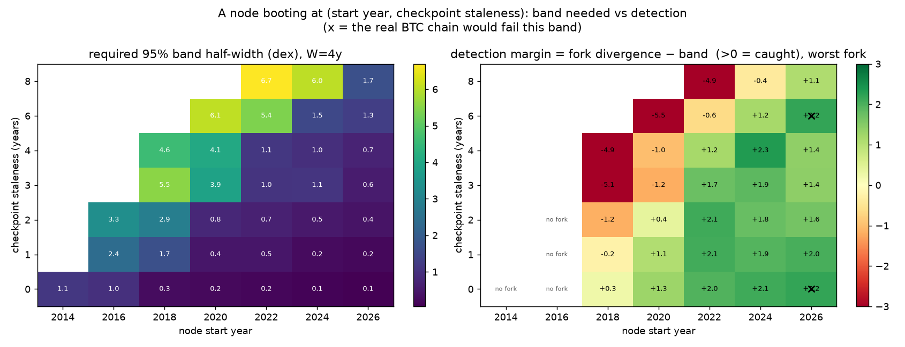
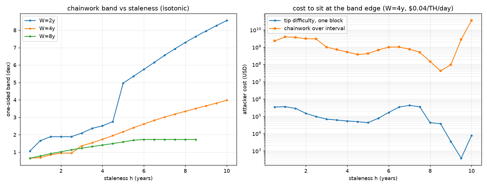

# partition-safe-ibd

Trend-based chain justification for header-compatible SHA256d chains.  A node
that is **network-partitioned** (e.g. it can only reach Bitcoin Cash peers)
should be able to tell that it *cannot yet finalize* blocks, rather than
silently following a minority chain.  This repo explores doing that from
**difficulty (hash rate) history alone**, using a trusted header history as a
reference trend.

The idea: over any multi-year window, the dominant chain's difficulty grows
along a fairly stable power law.  A minority fork does not — its hash rate
fraction erodes, so its difficulty falls ever further *below* that trend.  Judging
an incoming chain therefore reduces to measuring how far below the trusted trend
its difficulty sits, compared with the uncertainty band of the trend itself.

> Companion: the same problem also has a *work-share* solution (`fork_work.py`
> in the project this was extracted from, `partition` mode), which compares
> cumulative chainwork against a live anchor.
> The trend approach here is different in one important way: it needs **no live
> connection to the dominant chain**, so it keeps working *while you are
> partitioned*.  That is exactly the scenario this is for.

---

## 1. Which chains are comparable

Only chains that share Bitcoin's 80-byte header layout and SHA256d proof of work
have directly comparable difficulty / `chainwork`:

| chain | name | split from | fork height | fork date |
|-------|------|-----------|-------------|-----------|
| **BTC** | Bitcoin | — | — | 2009-01-03 (genesis) |
| **BCH** | Bitcoin Cash | BTC | 478558 | 2017-08-01 |
| **BSV** | Bitcoin SV | BCH (shares the BTC prefix) | 556766 | 2018-11-15 |
| **XEC** | eCash (BCHA) | BCH | 661648 | 2020-11-15 |

Merged-mined chains (e.g. Namecoin) are **excluded**: their SHA256d work is
shared with Bitcoin rather than independent, so their difficulty is not an
independent hash-rate measurement.  Scrypt/X11 chains (Litecoin, Dogecoin, Dash)
are excluded for a different reason — different PoW, so `chainwork` is not
comparable.

## 2. Data

* **BTC** — the checkpoint spine `checkpoints.txt`, copied into this repo from
  the parent repo's `crates/core/data/checkpoints.txt`: one header every 2016
  blocks, full history, offline.  (Difficulty is read straight from the `bits`
  field.)
* **BCH, XEC** — the [Blockchair](https://blockchair.com/api/docs) API, one
  request per sampled height (free tier ≤ 30 requests / 60 s, so the fetcher
  throttles itself).
* **BSV** — a public Bitcoin SV JSON-RPC node (`getblockheader`).

`fetch.py` caches everything to `data/<chain>.json` as
`[[height, unix_time, difficulty], ...]`.

> A caution discovered while building this: `bch.mempool.space` and
> `xec.mempool.space` both currently serve **Bitcoin mainnet** data (identical
> block hashes to `mempool.space`), so they are unusable for BCH/XEC.

## 3. Method

Fit, in log–log space, a power law to the trusted chain over a trailing window of
`W` years:

```
log10 difficulty = a + b · log10( t )        t = years since genesis
```

Then judge any chain by its **residual** at time `x`:

```
r(x) = log10 difficulty_chain(x) − (a + b · log10 x)
```

The uncertainty of the fitted line is the OLS **prediction interval**:

```
band(x) = m · s · sqrt( 1 + 1/n + (log10 x − x̄)² / Sxx )
```

where `s` is the fit's residual standard error, `n` the number of points, and
`(log10 x − x̄)²/Sxx` the **extrapolation penalty** — zero inside the fit window,
growing as you predict further outside it.  This automatically does what a node
should do: demand a tighter fit when it has more history, and widen its
expectations the older its trusted checkpoints are.

**`m` must be calibrated.**  Bitcoin difficulty is autocorrelated and
regime-shifting, so the raw OLS interval (m = 2) *under-covers*: measured
coverage of the true chain is only 30–90 % depending on window and staleness.
`calibrate()` measures the empirical 95th-percentile inflation factor `m(W, h)`
from BTC's own history, where `h` is the staleness (years since the fit window
ended).  `m` is forced monotone non-decreasing in `h` (a band cannot shrink as a
model ages).

### Decision rule

The node grades the **work the candidate has done since its trusted anchor**
(§7).  The earlier tip-difficulty residual is kept only for the analysis in
§4–§6, where it motivated the redesign:

```
dC < 2³² · D0                       → do NOT finalize; the chain has not grown
dC < Wtr / 10^band                  → do NOT finalize; below the rate edge
tip age > τ                         → do NOT finalize; not keeping up
otherwise                           → may finalize
```

`sustained` is what the elapsed interval gives for free.  `dC` is cumulative work
since the anchor and `T = t_now − t0` is the node's clock, so a divergence is
already integrated over the whole interval — there is no separate
"for N consecutive evaluations" test to define, and no single block clears it.
That is the point of the §7 change: the work gate subsumes the freshness gate
(a stalled chain has both a stale tip and too little work).

A fork that does **not** change its difficulty algorithm is the easy case: it
inherits the parent's target, so its difficulty matches the trend, but with a
small hash-rate share its `dC` over the interval is far below `Wtr`.  The August
2026 BIP-110 split is the clean example — it left Bitcoin at height 961 632 (an
exact retarget boundary), inherited the new epoch's difficulty, produced two
blocks, then stalled, and its own next retarget was years away, so nothing
resets the difficulty to hide behind.  A fork that *does* run a per-block DAA is
caught the same way: cutting difficulty keeps the 10-minute cadence but does not
change the work, so `dC` stays low.

Take `τ` as a small multiple of the target block interval.  `simulate.py` backs
the latency claim up at the block level (§9): below the rate edge `10^−band` the
work gate fires at the first check — `τ` ≈ 1 h in the backtest — in every trial,
while a genuine 50/50 split survives for days.  A chain that is merely behind
because it is still syncing is handled by *not finalizing yet*, not by calling it
invalid.


`simulate.py` — left: how often the gate fires within 7 days; right: how long it
takes on the traces that do fire.  The dotted lines are the rate edges
`10^−band`; to their left detection is immediate (≈ `τ`), and near-even splits
fall off a cliff above them.

`band` should also be inflated by the time-elapsed-since-last-refit (staleness),
which is exactly what the `h` axis of `tightness_vs_staleness.png` shows.  Every
band in §4–§6 uses `m_band()`, which applies the monotone guard (§4).  §7
replaces the point statistic `r(x)` with work accumulated since the anchor; the
difficulty form is kept in §4–§6 because those results are built on it.

## 4. Results

### Difficulty, log–log — `diagrams/difficulty_loglog.png`



All four chains share history until their respective forks, then diverge.  By
2026-08:

| chain | difficulty | BTC / chain | residual vs BTC trend |
|-------|-----------|-------------|-----------------------|
| BTC | 1.33 × 10¹⁴ | 1× | 0 (reference) |
| BCH | 4.30 × 10¹¹ | 309× | ≈ −2.5 dex |
| BSV | 3.17 × 10¹⁰ | 4196× | ≈ −3.6 dex |
| XEC | 6.34 × 10⁹ | 20 900× | ≈ −4.3 dex |

### Residuals vs a rolling 4-year BTC trend — `diagrams/residual_rolling.png`



This is the key picture.  The **true chain's residual is bounded** — it wanders
inside the shaded band (and through the 2011–2015 era is *outside* it, which is
why the band must be calibrated, not assumed), then hugs zero in the modern era.
The **forks' residuals are unbounded and monotone**: once a fork exists they fall
away from the trend without limit.

That asymmetry — bounded vs unbounded — is what makes the method robust to an
imperfect or somewhat stale model: you are not asking "does this match exactly",
you are asking "does this diverge without bound".

### The fork examples are illustrative, not clean controls

BCH, BSV and XEC show the long-run end state — a minority chain far below the
trend — but none of them is a clean test of a fork that simply *keeps going
slowly*:

* **BCH** launched in Aug 2017 with an Emergency Difficulty Adjustment (20 %
  cuts when blocks were slow), replaced in Nov 2017 by a per-block DAA.
* **BSV** forked from BCH in Nov 2018 already carrying BCH's per-block DAA.
* **XEC** forked from BCH in Nov 2020 with ASERT (`aserti3-2d`).

Their difficulty therefore falls quickly after the split **by design**, and their
early residuals measure that policy as much as hash-rate share.  Their long-run
hash rate also tracks market price, so a low residual is not purely a partition
effect.  The cleaner natural experiment is the opposite case: a fork that keeps
inherited difficulty and goes slow — see the BIP-110 split under the decision
rule, where the residual stays on the trend and only tip age / work rate exposes
the chain.  That fork stalled after two blocks, so it is not in `data/` (there is
no series to fit), but it is exactly the case the difficulty-only view would
miss.

### Fit tightness required vs staleness — `diagrams/tightness_vs_staleness.png`



The 95 % band you need, as a function of how old the trusted checkpoints are, for
history windows `W` = 2, 4, 8 years.  Two competing effects:

* **More history → smaller `σ` and slower band growth** (W=8 stays under ~1 dex
  even after 6 years of staleness), but a slightly wider band at zero staleness.
* **Less history → tiny `σ` but fast growth** (W=2 is tight now, ~1.5 dex after
  5 years).

Practical sweet spot: **W = 4–8 years**.  Reference points: ×10 = 1.0 dex,
×100 = 2.0 dex.  Beyond ~5 years of staleness the calibration is thin (few fit
windows in BTC's history reach that far), so treat those values as indicative.

### A node booting at (start year, checkpoint staleness) — `diagrams/start_grid.png`



This is the answer to *"what if a new node starts at some point in history with
`S` years of stale checkpoints before its first sync?"*  For each cell we fit the
trend to BTC up to `start − S` and ask (a) how wide the 95 % band is, and (b)
whether the fork chains that exist by then fall outside it.  This is the
**tip-difficulty** formulation — §7 supersedes it with the same grid on the
chainwork statistic, and that one is the canonical figure.

Reading it (W = 4y):

* **Left** — required band half-width in dex.  A node starting in 2020+ with
  ≤2 years of staleness needs only ~0.2–0.8 dex; one starting in 2018 with 6
  stale years needs ~6 dex.
* **Right** — detection margin = fork divergence − band, for the **worst** fork
  (`min` over the three).  Green (>0) means even the hardest fork would have been
  flagged; red means at least one would have been mistaken for consistent.  An
  **x** marks a cell where the *real* chain would fail its own band — the
  false-positive side, which the earlier version of this figure did not show.
  * Starting 2020 or later with ≤2y staleness: **every fork caught**, but the
    thinnest such cell is only +0.38 dex, and two 2026 cells (including the live
    one at `S` = 0) are marked x — the real chain fails its own band there.
  * Starting 2018 with 3–6y staleness (fit lands on the 2012–13 ramp): **missed**
    — those windows extrapolate badly.
  * The row for staleness 8 at 2026 is looser than its neighbours because the
    specific `[2014, 2018]` fit window happens to be unusually smooth; this
    variability is real and is why a single scalar threshold should be derived
    per-fit, not assumed.

The figure now uses the **worst** fork (`min` over the three), so the margins are
lower than the first version's best-case numbers — the thinnest claimed cell,
start 2020 with 2y staleness, is +0.38 dex — and it marks cells where the true
chain fails its own band.  The remaining caveat is that the band itself is
in-sample (below).

### Calibration is weaker than it looks — `calibration_audit.py`

Every "95 %" in this section is **in-sample**: `calibrate()` takes the 95th
percentile of the same overlapping fit windows it then scores, so coverage is
true by construction, and the monotone guard extrapolates a noisy in-sample tail.
Fixing `m` on windows before a cutoff and scoring after it gives, for W = 4
(nominal 95 %):

| staleness h | 0 | 1 | 2 | 3 |
|-------------|---|---|---|---|
| coverage after 2018 | 76 % | 53 % | 35 % | 18 % |

Support is thin at the top end too: 26 windows at h = 0 but 14 at h = 6 and 10 at
h = 8 for W = 4 (18 / 6 / 2 for W = 8).  And the true chain is flagged in about
2 of every 24–26 windows at each staleness — one of them is live.  BTC difficulty
peaked at 1.56 × 10¹⁴ on 2025-10-29 and is 1.33 × 10¹⁴ now; that is 0.22 dex
below a 1-year-stale trend against a 0.09 dex band, so **a node whose checkpoints
are 6–12 months old would flag real Bitcoin today** (W = 4 at h = 0.5–1, W = 2 at
h = 1).  The band is therefore both too tight in-sample and too optimistic out of
sample; the fix is walk-forward calibration with reported coverage, not a
percentile of the scoring set.  `calibration_audit.py` prints all of it: support
counts (A), walk-forward coverage (B), false positives including the live tip (C),
and worst-case fork margins (D).

## 5. Limitations

* **Same PoW only.**  The comparison is meaningless across different PoW.
* **Near-even splits.**  Right after a split *every* fork's residual is small by
  construction (it shares the trend), but that is only a latency for the
  difficulty channel.  A chain with a small hash-rate share is caught quickly by
  the tip-age / work-rate gate: it must either cut difficulty (large negative
  residual) or keep inherited difficulty and produce blocks hours apart (stale
  tip).  What remains genuinely ambiguous is a fork holding a large share of the
  hash rate — a near-50/50 split, where both chains produce recent tips at
  similar difficulty.  That is the same 50/50 problem as any work-based rule;
  `simulate.py` puts numbers on it (at a 0.94 dex band a 50 % fork escapes 86 %
  of traces over 7 days, versus 100 % detection of a 10 % fork at ≈ 1 h and of
  a 25 % fork within ~9 h).
* **Staleness.**  Confidence in the *difficulty* band is a decreasing function of
  years since the last trusted checkpoint: beyond ~2 years a small fork can hide
  inside it, and beyond ~5 years the calibration itself is thin.  The tip-age /
  work-rate gate does not decay with staleness — but its trust root is the
  **node's clock**, not the candidate's headers: header timestamps are
  attacker-chosen within MTP and `now + 2 h`, so an eclipsed node with a skewed
  clock is attackable through it.  That is why the two gates age differently.  At
  ten years the band stops being the defender's margin and becomes the forger's
  budget: see §6.
* **Regime shifts.**  BTC difficulty has drawn-downs (2011, 2015, 2018, 2022)
  where the true chain also leaves a tight band; this is why the band is
  calibrated empirically and why "sustained" divergence is required.
* **It ranks security share, not legitimacy.**  A heavy-but-minority chain is
  still a valid chain; this only measures whether it holds a dominant share of
  hash rate.

## 6. Attack cost at 10-year staleness

What if the trusted checkpoints are 10 years old?  `attack_cost.py` answers that,
and the answer is uncomfortable: the band that protects against a stale model is
also the forger's budget.  A chain passes if its difficulty is no more than
`band` dex below the trend, so the forger only has to sit at the **bottom edge**
of the band and does not need to approach Bitcoin's hash rate at all.

Setup: checkpoints end 2016-09-12 (height 429 408), candidate tip 2026-09-19
(height 967 680; BTC difficulty 1.33 × 10¹⁴, network ≈ 950 EH/s).  Prices are at
$0.04 per TH/s per day (≈ $40/PH/day), i.e. rented SHA-256 hash, and scale
linearly with it.

Bands go through `m_band()` (§3), which applies the monotone guard over the full
staleness grid.  That detail changes the answer: `calibrate()` only enforces "a
band cannot shrink as the model ages" across the `h` values it is handed, so
asking it for a single `h` skips the guard.  The guarded value is the running
maximum of the raw percentile over all smaller `h`, so at 10 years it is set by
whichever staleness estimated widest (raw → guarded: 17 → 21 for W = 2, 7 → 11
for W = 4).

| W | band (raw → guarded) | `D_min` / BTC tip | H for 10-min tips | 1 block | 1 day | cumulative work |
|---|----------------------|-------------------|-------------------|---------|-------|-----------------|
| 2y | 2.89 → **3.62** dex | 0.015 % | 0.14 EH/s (0.015 %) | $39 | $5.6 k | $4.4 M |
| 3y | 3.35 → **4.56** dex | 0.19 % | 1.8 EH/s (0.19 %) | $510 | $73 k | $37 M |
| 4y | 3.81 → **5.94** dex | 2.9 % | 27 EH/s (2.9 %) | $7.6 k | $1.1 M | $377 M |
| 5y | 1.42 → **4.90** dex | 2.1 % | 20 EH/s (2.1 %) | $5.6 k | $810 k | $319 M |
| 8y | undefined | — | — | — | — | no calibration window reaches h = 10y |

With the guard applied, **every** W = 2–5 keeps the true chain inside its own
band, so there is no "usable window" left to hide behind: a forger needs only
0.015–3 % of Bitcoin's hash rate.  (An earlier version of this section reported
W = 4–5 failing their own test and only W = 2–3 being usable; that was the
unguarded single-`h` artifact and is withdrawn.)

The cost depends on how much of the chain the node actually checks:

| what is checked | W = 2 | W = 3 |
|-----------------|-------|-------|
| tip difficulty + tip age only | ~$39 (one block) | ~$510 |
| sustained work rate, 1-day window | ~$5.6 k/day | ~$73 k/day |
| cumulative work from the anchor | ~$4.4 M | ~$37 M |
| — reference: Bitcoin's real 10-year work | ~$47 B | ~$47 B |

(W = 4 sits between the columns at $7.6 k / $1.1 M/day / $377 M.)  A forger needs
neither ten years nor Bitcoin's hash rate: if the rule looks only at the tip's
difficulty and freshness, a single block at the band edge — tens of dollars of
rented hash at W = 2 — clears both.  Requiring cumulative work since the anchor
raises the bar by the band factor (×4170 at W = 2), but does not remove it: at
ten years even that is single-digit millions, because the band is what sets the
price.  All of these are far below the ~$47 B that Bitcoin's own ten-year
chainwork would cost.

Two changes follow:

* **Cap staleness or absolute band width.**  Refuse to finalize once the band
  exceeds some absolute width, instead of letting it grow without bound.  A
  ten-year-old model is not a weak model; it is a different problem, and the
  cheap single-block attack is the symptom.
* **Require work, not just difficulty.**  Compare cumulative `chainwork` since
  the anchor with the trend's integral.  Difficulty is a point sample the forger
  can meet with one block; work is the quantity they cannot fake cheaply.

The tip-age / work-rate gate is the one part whose sensitivity does not decay
with staleness (§5), though its trust root is the node's clock, not header
timestamps.  The attack above is what remains — a forger who *does* keep tips
fresh — and its price is the band.

## 7. Redesign: grade the work, not the tip — `chainwork.py`

§6 shows why the difficulty residual is the wrong quantity: it is a point sample
that one block satisfies.  The natural statistic is the work the chain has
actually done since the trusted anchor, compared with what the trend says it
should have done in the time the node has been waiting:

```
T   = t_now − t0                          elapsed, from the NODE's clock
dC  = C1 − C0                             candidate work since the anchor
Wtr = ∫ D_tr(t) · 2³²/600 dt              trend work over [t0, t_now]
q   = log10(dC) − log10(Wtr)
```

Finality requires `q ≥ −band(W, h)` **and** a hard floor
`dC ≥ 2³² · D0`, where `D0` is the anchor's own (trusted) difficulty — without it
a wide band could accept a chain that has not grown at all.  Header timestamps
only enter through the work they certify; elapsed time is the node's, so it
cannot be shortened by choice of timestamps.  `finality.py` owns this rule —
statistic, calibration and decision — and `chainwork.py` reports on it.  The band
is calibrated on `q` for the true chain and made non-decreasing in `h` by
**isotonic regression** (PAVA), not a running max.  The fit is global (a node
ships the table), so the band cannot shrink with age.  For W = 4–8 the two agree
closely; for W = 2 at h = 2 the running max carries a spike forward (2.14 vs 1.89
isotonic), which is exactly the over-conservatism isotonic removes.  That is also
why the retired difficulty band was fragile: there the choice of smoother moved
the ten-year band by 30 %.

### Bands, coverage, and the live false positive

| W | h=0.5 | h=1 | h=2 | h=4 | h=10 |
|---|-------|-----|-----|-----|------|
| 2y | 1.07 | 1.66 | 1.89 | 2.51 | 8.56 |
| 4y | 0.65 | 0.69 | 0.94 | 1.73 | 3.98 |
| 8y | 0.65 | 0.78 | 1.02 | 1.40 | n/a |

Out-of-sample coverage is much better than the difficulty statistic's (band
fixed on tests before the cutoff, scored after; nominal 95 %):

| W = 4y | h=0.5 | h=1 | h=2 | h=4 |
|--------|-------|-----|-----|-----|
| band from ≤ 2018 | 100 % (b=0.82) | 100 % (b=0.93) | 94 % (b=0.94) | — |
| band from ≤ 2020 | 100 % (b=0.82) | 100 % (b=0.93) | 100 % (b=1.02) | 92 % (b=1.41) |

Support is thin at the top end, so `chainwork.py` also prints the window count
`n` and a bootstrap 5–95 % interval for every band, and flags anything below
`MIN_SUPPORT = 8`.  At W = 4 that is n = 25/24/22/18 with intervals
[0.27, 0.82], [0.36, 0.93], [0.49, 1.02], [1.40, 1.73] at h = 0.5/1/2/4, but
n = 6 and [2.12, 3.98] at h = 10 — flagged **THIN**, so the ten-year numbers in
§6–§7 are indicative only.  These are still in-sample percentiles; the honest
walk-forward bands come from the coverage columns above.

And the live false positive of §4 disappears: at the current tip `q` is
−0.17 … +0.15 for h = 0.5–4 at W = 4 — comfortably inside the band — where the
difficulty rule was flagging real Bitcoin at h = 0.5–1.  One historical window
per staleness still falls outside, all of them in the 2012–2019
ramp-and-drawdown era.

### Attacker cost

Sitting at the band edge no longer means one block: at W = 4 the attacker must
produce `Wtr / 10^band` hashes across the whole elapsed interval.

| h | tip difficulty: one block | chainwork: interval | ratio |
|---|---------------------------|---------------------|-------|
| 0.5y | $0.34 M | $2.3 B | ~6 700× |
| 1y | $0.36 M | $3.9 B | ~10 800× |
| 2y | $0.15 M | $3.1 B | ~20 900× |
| 4y | $53 k | $0.52 B | ~9 800× |

(The tip column assumes the attacker may choose the tip difficulty; that
assumption fails under real retarget rules at small `h` — see the next
subsection.)  $0.04/TH/day; one day of Bitcoin's present hash rate ≈ $38 M, so
$3.9 B ≈ 100 network-days.  The chainwork column is the redesign's point: it
turns "one block clears it" into "produce a large fraction of a year of network
work".



### But the attacker does not get to pick the tip difficulty — `attack_sim.py`

The "tip difficulty: one block" column is an upper bound on attacker *optimism*:
it assumes the fork may set its tip difficulty to the band edge.  A node
validating the candidate as a Bitcoin chain does not allow that — difficulty is
pinned by the retarget path from the anchor (2016 blocks, 4× clamp), so the fork
has to live with the difficulty its own hash rate earns.  `attack_sim.py` mines
that fork forward (honest Poisson timestamps, real retarget) and asks whether the
node would accept it:

| h = 0.5y, W = 4 | f = 0.05 | 0.1 | 0.2 | 0.3 | 0.5 | 1.0 |
|-----------------|----------|-----|-----|-----|-----|-----|
| tip-difficulty pass rate | 0 % | 0 % | 0 % | 0 % | 0 % | 0 % |
| chainwork pass rate | 0 % | 0 % | 0 % | 82 % | 100 % | 100 % |
| work cost | $0.38 B | $0.76 B | $1.5 B | $2.3 B | $3.8 B | $7.6 B |

Two things fall out.  The **chainwork closed form is accurate**: the simulated
minimum at `f` ≈ 0.3 costs $2.27 B against the closed-form $2.26 B.  And the
**tip-difficulty rule cannot be passed at all** here — its difficulty converges
to `f·D₀`, which is below a trend that expects growth, so no fork short of the
dominant chain's own hash rate passes, and even the dominant chain fails at these
`h` (§4's live false positive).  So the real choice is not "cheap point sample vs
expensive interval": it is a rule that is unusable in both directions versus one
that is calibrated and prices an attack at $2–4 B.

### The start grid on this statistic — `diagrams/chainwork_grid.png`

The same grid as §4, evaluated with work-since-anchor instead of tip difficulty.
A fork is judged only when its sampled series reaches back to the anchor, so
early cells are blank ("no fork"); the middle panel is the **worst** fork and the
right panel is the true chain.


Read against §4: the forks are caught (middle panel > 0) out to about two years
of staleness, and not beyond — which is the same failure the wide band produces
everywhere, not a datum about the forks.  The right panel is uniformly positive
out to `S` = 8, i.e. the redesign removes the §4 false positives at every point
shown.

### Operating envelope — how stale can the checkpoints be?

"Cap staleness" needs a number.  `chainwork.py` reports the largest `h` at which
the rule is supportable: at least `MIN_SUPPORT` windows, walk-forward coverage
≥ 95 % on tests after 2020, band ≤ the cap, and the live true chain inside it.

| W | band ≤ 1.0 dex | band ≤ 2.0 dex |
|---|----------------|----------------|
| 2y | none | h ≤ 1y (band 1.85, cov 100 %, n = 28) |
| 4y | **h ≤ 1y** (band 0.93, cov 100 %, n = 24) | **h ≤ 3.5y** (band 1.54, cov 100 %, n = 19) |
| 8y | none | none |

The tip-difficulty statistic has **no valid envelope at any W**: its
walk-forward coverage never reaches 95 % (it was 76 % → 18 % across `h`).  So the
concrete recommendation is W = 4 with staleness capped at roughly **one year**
for a ≤ 1 dex band (three and a half years at ≤ 2 dex), and never the
difficulty formulation.

### What this fixes, and what it does not

* It removes the **point-sample** weakness: no single block clears the test, and
  timestamp choice cannot shorten the interval.
* It does **not** fix **staleness**.  The band still grows without bound — 3.98
  dex at ten years for W = 4, 8.56 for W = 2 — and at h = 10 the live `q` passes
  by only 0.14 dex on 6 samples.  The floor keeps a *non-growing* chain out, but a
  forger who does grow can still sit at the widening edge, so **capping staleness
  (§6) remains necessary** — see the envelope above for the number.
* "Sustained" is defined as the **whole interval** `[t0, t_now]`.  A shorter
  trailing window is a weaker variant that would need its own calibration; using
  the whole interval is what makes elapsed time non-negotiable.

## 8. Files

```
partition-safe-ibd/
  fetch.py             # download/cache difficulty series -> data/<chain>.json
  analyze.py           # fit, calibrate, and draw all four diagrams
  attack_cost.py       # cost of a forged chain at a given checkpoint staleness
  calibration_audit.py # support, walk-forward coverage, false positives, margins
  chainwork.py         # §7 report + figures for the work-since-anchor rule
  finality.py          # canonical rule: statistic, isotonic band, decide()
  attack_sim.py        # block-level attacker under the real retarget path
  simulate.py          # block-level Poisson backtest of the freshness/work gate
  simulate.py          # block-level Poisson backtest of the freshness/work gate
  checkpoints.txt      # trusted BTC header spine (one header per 2016 blocks)
  data/                # cached series (BTC, BCH, BSV, XEC)
  diagrams/            # generated PNGs
  README.md            # this file
```

### Running

```sh
python3 -m venv .venv && . .venv/bin/activate
pip install matplotlib          # and numpy (pulled in by matplotlib)

python3 fetch.py                # BTC is offline; BCH/XEC hit Blockchair, BSV a public node
python3 analyze.py              # writes diagrams/*.png and prints the band table
python3 attack_cost.py          # forged-chain cost at 10y staleness; args: [years] [$/TH/day]
python3 calibration_audit.py    # calibration support, coverage and false positives
python3 chainwork.py            # §7 work-since-anchor statistic + band, coverage, cost
python3 finality.py             # canonical rule: bands, live decision, envelope
python3 attack_sim.py           # block-level attacker under real retarget; args: [trials]
python3 simulate.py             # block-level Poisson backtest of the gate; args: [trials] [days]
```

`fetch.py` caches: delete `data/<chain>.json` to refetch.

## 9. Where this could go next

* **(done, §7) Grade work since the anchor, not tip difficulty.**  The chainwork
  statistic removes the single-block attack and is DAA-invariant: a fork that
  lowers difficulty to keep 10-minute blocks and one that keeps inherited
  difficulty and produces slow blocks both show the same low work.  Still open:
  a trailing-window "sustained" variant, calibrated separately from the
  whole-interval rule.
* **(done, `simulate.py`) Poisson backtest of the gate.**  Honest Poisson
  arrivals, inherited difficulty, real 4×-clamped retarget.  Below the rate edge
  `10^−band` the work gate fires at the first check (≈ `τ`, 1 h) in every trace;
  a 50 % fork escapes 86 % of 7-day traces at a 0.94 dex band, which is the
  residual 50/50 case quantified.
* **(done, `attack_sim.py`) Block-level attacker.**  Under the real retarget path
  the chainwork closed form holds ($2.27 B simulated vs $2.26 B closed-form at
  f ≈ 0.3, h = 0.5), and the tip-difficulty rule turns out to be unpassable by
  any sub-dominant fork (its difficulty converges to `f·D₀`, below the trend).
  That corrects the "one block" pricing for the difficulty rule at small `h`; at
  h = 10 the inherited difficulty is already above the band edge, so one block
  remains enough there.
* **(done, `finality.py`) One rule module, isotonic calibration.**  Statistic,
  calibration and decision now live in one place; the non-decreasing band uses
  isotonic regression (PAVA) rather than a running max, which agrees with it for
  W = 4–8 and removes the carried-forward spike for W = 2.  Remaining: a full
  walk-forward table with intervals across every `W`, and an upper-confidence
  rather than point band.
* **(done, §7) Start grid on the chainwork statistic.**  `diagrams/chainwork_grid.png`,
  with the worst-case fork and a true-chain panel; §4's difficulty grid now uses
  the same worst-case convention and marks true-chain failures.  The operating
  envelope is stated (W = 4, staleness ≤ ~1y).  Remaining: a starting-anchor
  variant that evaluates at the *tip* rather than the start year.
* Move the reference model (`a, b, s, x̄, Sxx, n, fit_end`) and the `band(W, h)`
  table into a node's header validation path, alongside its trusted-checkpoint
  handling, so a node can self-assess a partition.
* **Cap staleness or absolute band width.**  Both statistics degrade the same
  way at large `h` (§6, §7), so a maximum band (or maximum checkpoint age)
  belongs in the rule itself, not a footnote.
