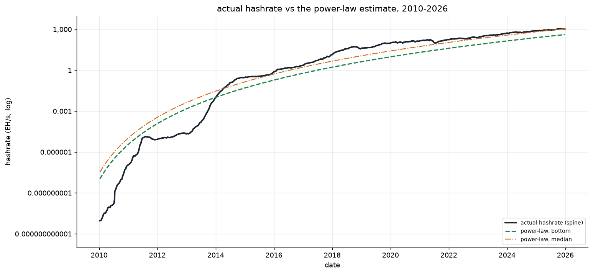
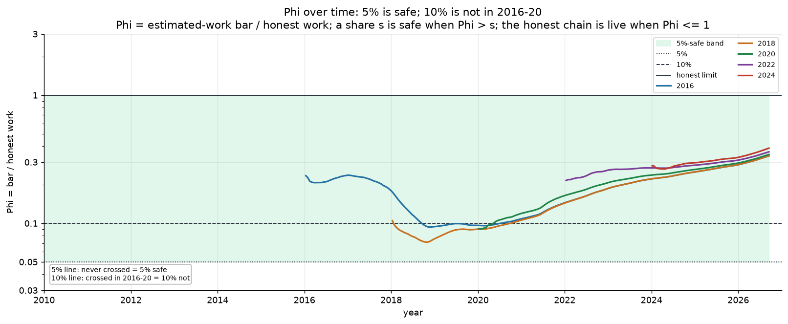
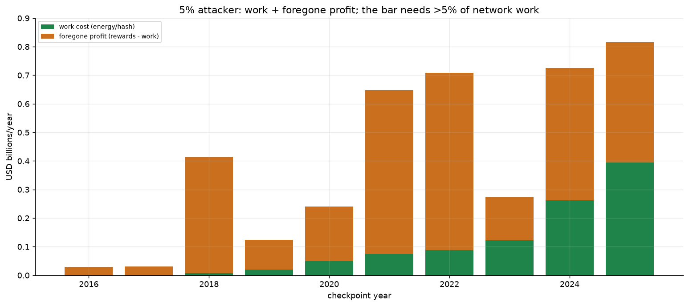

# Partition-safe IBD

**Finalizing a downloaded chain without asking peers whether it is the best one.**

A node that bootstraps from scratch trusts its peers, because it has no local
history to check them against. An eclipse, or a partition that leaves it talking
only to a fork's peers, can feed it a chain that is valid but not the best one.

This removes that trust for **finality**. The node ships with a trusted header
spine up to a checkpoint $t_0$. It finalizes a downloaded chain only once that
chain proves it carried enough work since $t_0$. Work has to be hashed, so a
partition cannot forge it. The only other input is the node's clock.

## The setup

```text
spine (trusted)        t0 ──────────── T = now − t0 ───────────► now
 ━━━━━━━━━━━━━━━━━━━━━━━━●
                         │ honest  ▕██████████████████████▏ W_h        ✔ ≥ bar
                         │ bar     ▕┄┄┄┄┄┄┄┄┄┄┄┄┄┄┄┄┄┄┄┄┄┄▏ r₀·ĥ(T)    ◄ threshold
                         │ fork    ▕████▏                   s·W_h      ✘ < bar
```

The trusted spine ends at $t_0$. After $t_0$ the honest network produces work
$W_h$, while a fork with share $s$ produces $s\,W_h$. The node knows
$T=t_{\text{now}}-t_0$ from its clock. The bar is a threshold on the work since
$t_0$.

## Estimate the work

The rule needs an estimate of the honest work over the anchor's age. The
estimate comes from a published Bitcoin price power law, converted to hashrate
with the `dbtc` relation:

$$
P(d)=10^{-17.432}d^{5.834},
\qquad
D=D_0\left(\frac{P}{P_0}\right)^{1/b},
\qquad b=0.673473.
$$

$d$ is days since genesis, $P$ is USD/BTC, and $D_0,P_0,b$ are the frozen
`dbtc` constants. The price-to-difficulty conversion follows
[dbtc](https://github.com/Nuhvi/dbtc). The resulting estimate is compared with
the realised hashrate from the spine:



The estimate is a trend, not a precise forecast. It is above the realised
hashrate before 2014, below it in 2015–2021, and close again after 2022. The
**bottom** law (green) is the conservative level; the **median** law (orange)
is the central one. On 2016+ checkpoints the bottom estimate is
$0.08/0.23/0.34$ of actual (p5/median/p95); the median estimate is
$0.22/0.62/0.92$.

Let $\hat h(T)$ be the cumulative power-law work since $t_0$, in checkpoint
blocks, and let

$$
r_0=\frac{H_{\text{est}}(t_0)}{H_{\text{actual}}(t_0)}.
$$

The **estimated-work bar** is

$$
\boxed{\;\text{bar}(T)=r_0\,\hat h(T)\;}
$$

and the node finalizes iff the candidate's chainwork since $t_0$ is at least
$\text{bar}(T)$. $r_0$ is a checkpoint constant: it can be shipped with the
spine, so the node needs no live price feed.

## The 5% rule

Let

$$
\Phi(T)=\frac{\text{bar}(T)}{\text{honest work}(T)}.
$$

The honest chain finalizes iff $\Phi\le 1$. A fork with share $s$ finalizes iff
$\Phi\le s$. So a **5% attacker is kept out exactly when**

$$
0.05<\Phi\le 1.
$$

The estimated-work rule over the 2016–2024 checkpoints:



The shaded band is the 5%-safe band, $0.05<\Phi\le1$. The **5% path stays inside
it throughout**: 5% is safe. The 10% path dips below $0.10$ in 2016–2020, so 10%
is not the assumption. The 2022+ paths are above 10%; 10% is safe there, but not
over the whole backtest. The empirical edge is 6% (5% and 6% are blocked at every
checkpoint; 7% has a 2018 patch). **5% is the conservative choice; 10% is not.**

## The cost of 5%

A 5% attacker is a 5% share of the network. It has two costs per year:

* **work cost** — the energy/hash cost of running 5% of the network;
* **opportunity cost** — the block rewards it gives up by not mining the real
  chain.



| year | work cost | rewards foregone | net |
|---:|---:|---:|---:|
| 2016 | \$0.4M | \$28.5M | \$28.1M |
| 2017 | \$1.1M | \$30.6M | \$29.4M |
| 2018 | \$6.9M | \$414M | \$407M |
| 2019 | \$20.2M | \$124M | \$104M |
| 2020 | \$49.6M | \$240M | \$190M |
| 2021 | \$74.0M | \$649M | \$575M |
| 2022 | \$87.6M | \$708M | \$621M |
| 2023 | \$122.5M | \$273M | \$150M |
| 2024 | \$263.0M | \$726M | \$463M |
| 2025 | \$394.5M | \$816M | \$421M |
| **2016–25** | **\$1.02B** | **\$4.01B** | **\$2.99B** |

The 5% share is affordable. The figure stacks the **work cost** (energy/hash)
and the **foregone profit** (rewards minus work); their sum is the rewards
foregone. Stacking work plus rewards would double-count the energy inside the
rewards. The rule resists the 5% share **because 5% of the honest work is below
the estimated-work bar**, not because the share is expensive. The cost table is
the budget input; 5% is the share assumption.

## Limits

* **The estimate is not exact.** The price/hashrate relation is above actual
  before 2014 and below it in 2015–2021; the backtest is the evidence, not a
  proof. The bottom law is used because it is the conservative level.
* **5% is the conservative choice.** The empirical maximum is 6%; 10% passes in
  the 2018–2020 low-estimate years. The 5% is the safe target, not the edge.
* **The honest chain has to stay live.** The rule is useful only while
  $\Phi\le1$. In the 2016–2026 backtest the bar is below the observed honest
  work. The only honest-denial point is the 5-year extrapolation for the 2024
  anchor ($\Phi\approx1.47$); its observed 2.7 years stay live.
* **No consensus change.** The bar is a local finality policy. The power-law
  level is an off-chain input at the checkpoint; the node can ship $r_0$ with
  the spine.
* **The 5% cost is not the bar's cost.** The 5% attacker spends 5% of the
  network; the bar may demand more than 5% of the honest work. That gap is the
  security.

## Deployment

1. Ship a spine to $t_0$; this is the trust root.
2. Ship $r_0$ (or the checkpoint price and hashrate) with the spine.
3. Read $T=t_{\text{now}}-t_0$ from the clock.
4. Compute $\text{bar}(T)=r_0\,\hat h(T)$.
5. Finalize iff the candidate's chainwork since $t_0$ is at least
   $\text{bar}(T)$.
6. Re-anchor on each cleared batch; $T$ resets and the bar restarts.

## Reproduce

```sh
python3 -m venv .venv
.venv/bin/pip install matplotlib numpy
cd research
../.venv/bin/python run_all.py
```

The scripts are `estimated_hashrate.py`, `estimated_work_history.py`, and
`cost_5pct.py`; `model.py` is the spine and the estimated-work bar. Data is in
`research/data/`.
