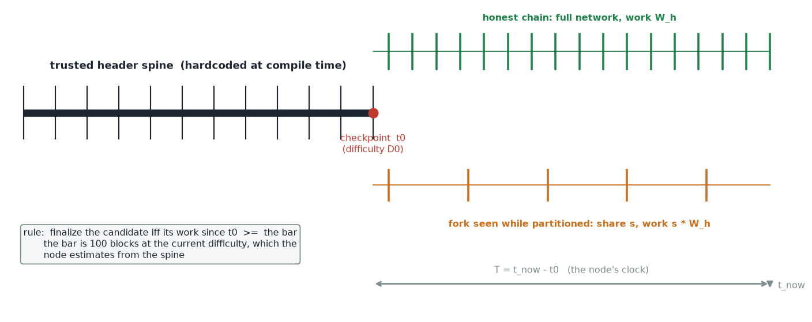
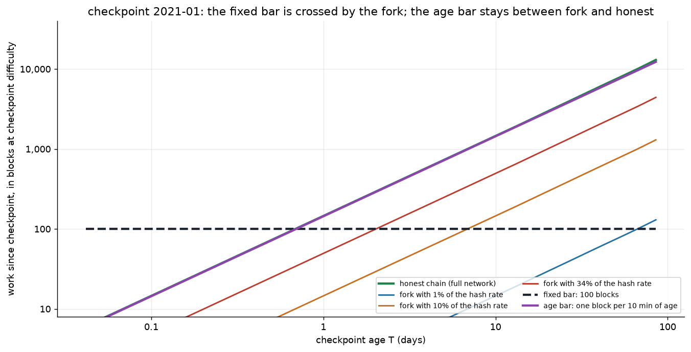
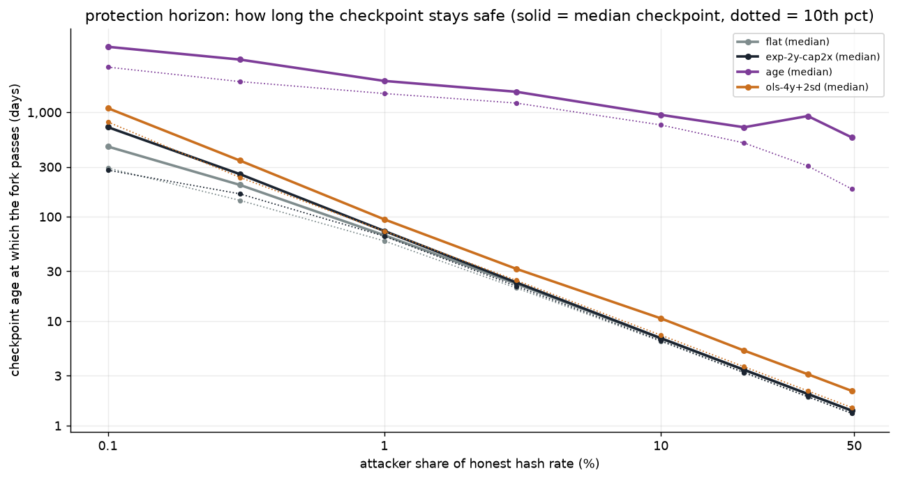
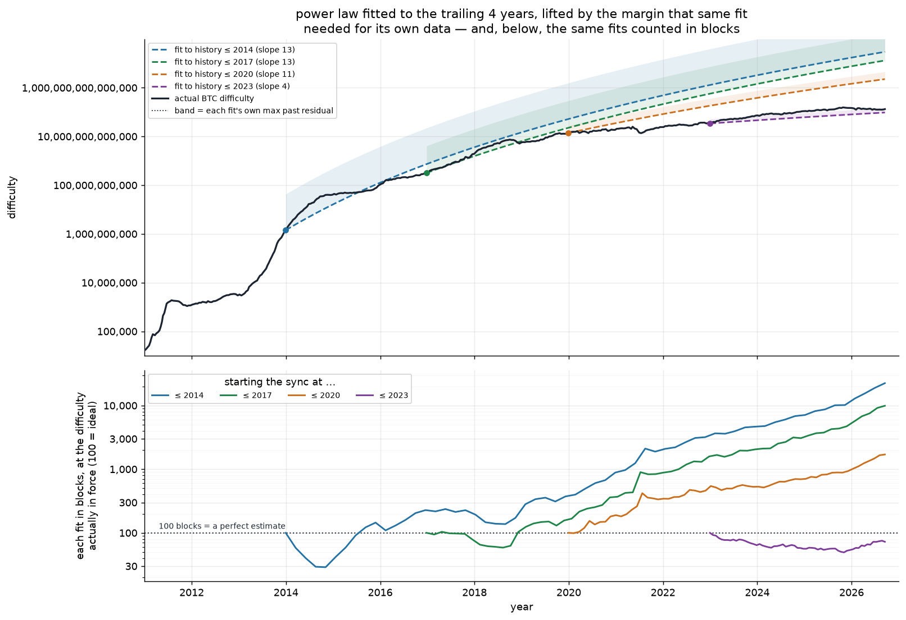
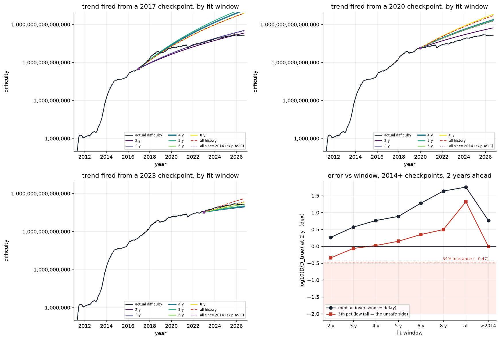

# Partition-safe IBD — resisting network partitioning during initial block download

*Glossary.* **chainwork** — the total hashing effort in a chain: the sum of the
per-block work `w = D·2³²` over its blocks, for block difficulty `D`.
**spine / checkpoint** — Bitcoin's real headers, hard-coded up to a checkpoint
`t0`. **finalize** — treat the chain as settled rather than waiting for the
network (no further reorg expected). **attacker share `s`** — the attacker's
fraction of the honest chain's hash rate, so its work over an interval is
`s · W_honest`.

## TL;DR

Finalize the downloaded chain only once the candidate carries, measured in
blocks of work at the checkpoint difficulty,

    c  ≥  max( 100 · ρ ,  T/600 )

    c   =  C / w0     the candidate's chainwork since t0, in checkpoint blocks
    w0  =  D0 · 2³²   work of one block at the checkpoint difficulty D0
    ρ   =  ŵ / w0     estimated work of one block now, relative to the checkpoint
    T   =  t_now − t0 (the node's clock); and 600 = seconds per block

Estimate `ρ` by fitting the **work per block directly** as a power law in chain
age, anchored at the checkpoint:

    ρ(t0,T) =  κ · ( 1 + T_y / a0 ) ^ p          T_y = T in years

    a0  =  the checkpoint's age, in years
    p   =  least-squares slope of log10(work per block) on log10(age), trailing 4 y
    κ   =  10^r ≥ 1, the band that same fit needed for its own history

The trend `(1 + T_y/a0)^p` is `1` at `T = 0`; the band `κ` lifts it, so
over-estimating only delays finalization. Validated on 2014+ checkpoints — the
post-ASIC regime — its 5th percentile never under-shoots. The bar holds for
**years** against a ~1% attacker; past that a node must adopt a newer checkpoint
(upgrade) or fail closed rather than finalize.

## The idea

A node doing initial block download has no independent way to know that the
chain it is pulling is the chain the network is on. It trusts its peers — so an
eclipse, or a network partition that leaves it talking only to a fork's peers,
can feed it a chain that looks valid but is not the best chain. The node finds
out too late, when it reorgs out of transactions it had already treated as
settled.

Partition-safe IBD removes that trust **for finality** — the node still fetches
the chain, but never asks its peers whether it is the best one. The node ships
with a **trusted header spine**: Bitcoin's real headers, hard-coded up to a
checkpoint `t0`. From the spine it knows the network's historical **work rate**,
and so can estimate how much work the network is doing *now*. It then refuses to
finalize the chain it is downloading until that chain proves it carried
comparable work — at least the work of `100` blocks at the difficulty estimated
to be **current**:

```
c  ≥  100 · ρ          c = chainwork since t0 (checkpoint blocks), ρ = ŵ / w0
```

This is the **coinbase-maturity assumption applied to sync**: the network already
treats producing 100 blocks at the current difficulty as out of reach, which is
why a coinbase may be spent after 100 confirmations. We estimate that per-block
work on the high side, so the bar never under-counts, and anyone able to clear it
could equally have reverted Bitcoin's last 100 blocks — a strictly more damaging
attack we take to be practically impossible. The node needs only the spine and
its own clock.

Two properties do the work:

* the spine is **fixed at compile time**, so a partition cannot rewrite it;
* the bar is denominated in **current** work per block, which the spine lets the
  node *estimate* but an attacker cannot *forge* — work has to be hashed.

The one real design question is how far a *fixed* bar holds as the checkpoint
ages. The reorg-equivalence argument above says nothing about time, and a fork's
accumulated work grows with the elapsed time `T` while the 100-block bar stands
still — so the constant is eventually overtaken. The fix is to let the bar grow
with `T`, which is the statistical argument of §2 and adds the second term to the
rule. Overshoot only delays finalization, but the guarantee still cannot last
forever.

A node whose spine is older than that limit must either **upgrade** — trusting a
newer, subjective checkpoint shipped in the new binary — or **fail closed**,
refusing to finalize rather than settle a chain it cannot vouch for. A horizon of
a few years is only usable if nodes upgrade on roughly that cadence; that is a
deployment assumption, not something this study measured.

The rest of this note finds that limit and backtests it on Bitcoin's real
history. (Experiments and lab notebook: [`research`](research).)

## What the study showed

* A **fixed** 100-block bar is overtaken with age: a minority fork keeps mining,
  so its work grows hour by hour while the bar stands still. It holds a 1%
  attacker for only ~70 days and a 34% attacker for ~2 days
  ([`horizon.png`](research/figures/horizon.png)).
* So the bar must grow too. Keep 100 blocks as a **floor** and add the work a
  chain at the checkpoint difficulty would have done over the checkpoint's age
  `T = t_now − t0` — that is `T/600` blocks (`600` seconds per block, so ~17 h
  buys 100). The bar is the larger of the two, `max(100·ρ, T/600)` (checkpoint
  blocks); past ~17 h the age term wins and forks stay out for **years instead
  of days** ([`bars.png`](research/figures/bars.png),
  [`security.png`](research/figures/security.png)).
* The fragile part is guessing the work of a block *now*. Over-estimating is
  safe — it only delays finalization. Under-estimating is what hurts: the bar
  sinks toward the fork's work, which is a share `s` of the honest chain's, so
  the estimate may come in at most `1/s` low — ~100× for a 1% attacker, but only
  ~3× for 34% (§4).
* Work per block is a **power law** in chain age, not an exponential: over
  2014–2026 a log-log fit describes it far better (R² 0.96 vs 0.83), because
  growth decelerates with age. The recommended estimate is that power law,
  anchored at the checkpoint, lifted by the band `κ` that same fit needed for its
  own history — so its low tail never under-shoots on 2014+ checkpoints
  ([`plaw_band.png`](research/figures/plaw_band.png)).

---

## 1. The setup



The node holds a spine of real headers to `t0` (one per retarget period is
enough). A candidate that descends from the spine is accepted iff its work since
`t0` clears the bar. The node sees only one chain, so the honest chain and an
`s`-share fork are indistinguishable except through their work.

`t0` need not be the shipped checkpoint. Any history the node already
**trusts** serves as the anchor — including a chain it finalized in an earlier
session — and a fresher anchor means a smaller, cheaper bar (§5).

Work is measured in hashes: a block at difficulty `D` contributes the **work**
`w = D · 2³²`. Write `W_cand` for the candidate's chainwork since `t0`,
`w0 = D0 · 2³²` for one block at the checkpoint difficulty, and `ŵ` for the
estimated work of one block now. Everything is in **checkpoint blocks** — work
divided by `w0` — so the candidate carries `c = W_cand / w0` blocks and the
estimate is `ρ = ŵ / w0`. The node's test is `c ≥ 100 · ρ`. Divide by the honest
chain's work, `W_honest`, and one dimensionless number governs:

```
Phi(t0,T) = bar / W_honest = max( 100·ρ , T/600 ) / h

h(T)   = W_honest(t0, t0+T) / w0   (honest work in checkpoint blocks)
       = G(T) · T/600              with G = interval's mean work per block / w0
ρ      = ŵ / w0                    (the node's estimate vs its start)
```

* the **honest** chain finalizes iff `Phi ≤ 1`;
* a fork of hash share `s` is kept out iff `Phi > s`.

So the rule is correct exactly on the band

```
s  <  Phi(t0,T)  ≤  1                  (safe band)
```

Too small and a fork slips through; too large and even the honest chain is
denied. `Phi` falls as `T` grows, so the band is a **window in staleness**
([`window.png`](research/figures/window.png)). Controlled overshoot of `ρ`
(`ρ>1`) raises `Phi`: it costs availability, never safety.

## 2. Why a fixed bar is overtaken



The honest chain and an `s`-fork both accumulate work in proportion to the
elapsed interval,

```
h_honest(T) ≈ G · T/600           (T/600 = target blocks in the interval)
h_fork(T)   = s · h_honest(T)                        all in checkpoint blocks
```

so a **constant** bar `100·ρ` is crossed by the fork once its work reaches it,
`s · h_honest(T) ≥ 100 · ρ`.

The protection horizon is finite and shrinks with the attacker's share (median
over 2014+ checkpoints):

| rule | s=0.1% | s=1% | s=10% | s=34% |
|---|---|---|---|---|
| fixed 100 blocks (`100·ρ`) | 1.3 y | 0.2 y | 6 d | 2 d |
| **age bar (flat bar)** | **5.2 y** | **6.6 y** | **2.4 y** | **1.5 y** |
| log-log trend fit (OLS) + 2 sd | never | 0.2 y | 11 d | 3 d |

The spread across checkpoints is wide: for the age bar, the worst tenth of
checkpoints hold only 3.4 y at `s=1%` and 0.3 y at 34%, so read these as medians,
not guarantees.



Solving `Phi > s` gives the horizon

```
T_hi(s) ≈ 60000 · ρ / (G · s)               (T/600 = 100·ρ/(G·s) blocks)
```

i.e. a fork of share `s` clears a constant bar once it has mined for that long.
Because `T` sits in the numerator, **no constant bar can hold** — the margin is
forced to scale with `T`, which is exactly why the second term (`T/600` blocks)
exists. A constant bar of 100 blocks survives only to `T/600 ≤ 100 · ρ/(G·s)`.

## 3. The age bar is far stronger, and what it costs

The second term, `T/600` checkpoint blocks, is the work a chain at the checkpoint
rate would have done. It asks `T/(60000·ρ)` times more than 100 current-difficulty
blocks — 43× at 30 days, 526× at a year.


| fraction of 2014+ checkpoints a fork PASSES | 1% fork | 34% fork |
|---|---|---|
| fixed 100 (`100·ρ`), at 90 d | **96%** | 100% |
| fixed 100 (`100·ρ`), at 1 y | **100%** | 100% |
| age bar, at 90 d | 0% | 0% |
| age bar, at 1 y | 0% | 11% |
| age bar, at 2 y | 3% | 40% |

The cost is availability — the flat bar denies the true chain in drawdowns
(`G<1`) and under short-interval block-count variance:


| fraction of checkpoints that DENY the true chain | 1–7 d | 30 d | 90 d | 1 y | 2 y |
|---|---|---|---|---|---|
| fixed 100 (`100·ρ`) | 0% | 0% | 0% | 0% | 0% |
| age bar (flat) | 30% | 28% | 16% | 4% | 0% |

(The recommended `max(100·ρ, T/600)` differs from the pure flat bar only for
`T ≲ 17 h`, where the 100-block floor delays the honest chain by design; it adds
no security there, since the flat bar is already safe at short staleness.)

So it is a clean trade: **the fixed bar buys availability at all staleness by
giving up security after days-to-weeks; the age bar gives up a little
availability early and stays secure for years.** Because delayed finalization is
acceptable (§1), the age bar is the better operating point, and the 100-block
rule is best used as its floor:

```
bar(T) / w0 = max( 100 · ρ ,  T/600 )          (checkpoint blocks)
```

## 4. The estimate must not under-shoot by more than `1/s`

Whatever the bar's shape, `ρ` enters `Phi` directly. The bar must sit between the
fork's work (`s·h`) and the honest chain's (`h`), a window of width `1/s`, and
`ρ` scales the bar. Over-shooting `ρ` only delays finalization; the danger is
under-shooting — the bar sinks toward the fork. So the estimate may come in at
most `1/s` **low**: 100× for a 1% attacker, only ~3× for 34%.

The recommended estimator is a **power law in chain age**, fitted on the **work
per block itself**. Work per block is described far better by a power law than by
an exponential — over 2014–2026 a log-log fit gives R² 0.96 against 0.83 for a
straight line — because the realised growth rate *decays* with age, from
~1000×/yr in 2012 to ~1.5×/yr in the 2020s. That decay is the power-law signature
(`rate ∝ 1/age`), and a constant-rate exponential cannot follow it. The estimate
is

    ρ(t0,T) = κ · ( 1 + T_y / a0 ) ^ p          T_y = T in years

with `p` the least-squares slope of `log10(work per block)` on `log10(age)` over a
trailing **4-year** window, the trend **anchored** so it is `1` at `t0`; and the
band `κ ≥ 1` is not a constant — it is `10^r`, the **largest relative departure
that same fit needed to contain the history it was fitted to**. A stretch where
work wandered off the line gets a wider band, and the band is applied one-sided
(upward), so over-shoot only delays finalization.

Fitting work rather than difficulty is not a change of model, it is the same
line: `log10 w = log10 D + log10 2³²` shifts every point by the same constant, so
the slope, the residuals and the band are unchanged. What goes away is the `2³²`
factor threaded through the algebra and the separate `y0 = log10 D0` anchor — the
fit is anchored on `w0`, `ρ` is dimensionless, and the bar is simply `100·ρ`. The
accuracy table below is `ŵ/w_true`; §1's `ρ = ŵ/w0` differs from it by the growth
factor `G`.

**Scope.** The estimate is validated on 2014+ checkpoints, the post-ASIC regime.
A fit to 2012–13 history under-shoots the ASIC transition badly (2,500×
difficulty in two years); the trailing-growth exponential absorbs that transition
by over-shooting instead, so this is a real limitation of the power-law form,
traded for a much better low tail in the modern regime.

| `log10(ŵ/w_true)` (dex; 2.0 = 100×), 2014+ | 30 d (p5/p50/p95) | 90 d | 1 y | 2 y |
|---|---|---|---|---|
| flat (no growth) | −0.11 / −0.03 / +0.02 | −0.34 / −0.07 / +0.04 | −0.84 / −0.24 / −0.04 | −1.45 / −0.49 / −0.20 |
| growth, 3 y (exponential) | −0.04 / +0.01 / +0.11 | −0.08 / +0.03 / +0.31 | −0.19 / +0.20 / +1.04 | −0.18 / +0.51 / +1.96 |
| log-log trend (OLS), 4 y, unanchored | −1.08 / +0.04 / +0.62 | −1.15 / +0.05 / +0.69 | −0.78 / +0.04 / +0.96 | −0.71 / +0.15 / +1.05 |
| **power law, 4 y + own band (recommended)** | **+0.12** / +0.33 / +1.68 | **+0.13** / +0.35 / +1.75 | **+0.12** / +0.52 / +2.23 | **+0.02** / +0.76 / +2.60 |

Reading: the **flat** guess under-shoots whenever difficulty grows (the only
unsafe direction), and the unanchored **log-log trend (OLS)** is poor even at one
day — its fitted value at `t0` sits far from the work actually in force there,
which anchoring at `w0` fixes. The recommended power law has the best low tail:
its 5th percentile is *above zero* at every horizon (the estimate never comes in
under the truth), so it never under-shoots in the 2014+ sample, at the cost of
over-shoot from the self-calibrated band. A **fixed** multiple (e.g. ×50) would
have to be sized for the worst era and then over-shoots everywhere else; a band
that reflects how far the line actually wandered calibrates itself per
checkpoint.



In [`plaw_band.png`](research/figures/plaw_band.png) the top panel shows four
fits, each with the band it needed for its own history. The **bottom panel counts
the same fits in blocks**: `100 · ρ(t) · w0 / w_true(t)` blocks at the work
actually in force, since the bar is 100 blocks at the *estimate*. A point on a
line is where a node is if it **starts syncing then**; `100` is a perfect
estimate, above it an over-shoot (a delay), below it an under-shoot (the unsafe
way). The recent fit sits below 100 near the end (it under-predicts); older fits
run far above it, and the further back they start the higher they climb — the
finite horizon in block terms.

Each point is only the **first** bar, though. Once the chain clears it and those
blocks are finalized, they become a new, trusted anchor, and the node measures
work from *there* with a fresh bar — so finalization is progressive: the first
bar is the expensive one, and each batch of finalized blocks pulls the next one
back toward 100. A node that has synced before pays almost none of this, because
it anchors on the history it already holds (§5).

The one free choice is the **window length**, and it is a clean trade: a shorter
window tracks the current regime and over-shoots less, a longer one is more
conservative. At 2 years ahead on 2014+ checkpoints the 5th percentile / median
run `−0.34/+0.27` at 2 y, `−0.06/+0.57` at 3 y, `+0.02/+0.76` at 4 y,
`+0.15/+0.88` at 5 y, up to `+1.32/+1.75` for the whole history — every window is
inside the 34% tolerance, so the choice is about delay, not safety
([`plaw_window.png`](research/figures/plaw_window.png)). **4 years** sits where
the low tail first clears zero; 3 years is the lower-delay alternative if a
slightly negative tail is acceptable.



## 5. Recommended rule

1. Ship a spine to `t0`; this fixes `w0` (and with it the unit).
2. Estimate the work of one block now, in checkpoint blocks, as a **power law** —
   anchored so the trend is `1` at `t0`, fitted over a trailing 4 years, lifted by
   the band `κ` that same fit needed for its own history:
   `ρ = κ · (1 + T_y/a0)^p`. Over-estimating is safe, so the band is only a delay.
3. Finalize iff

   ```
   c(t0 → tip)  ≥  max( 100 · ρ ,  T/600 )          c = chainwork / w0
   ```

   i.e. **100 current blocks and at least the checkpoint's age in blocks.** The
   band is small (it only has to cover the fit's own wander), so the honest chain
   is finalized within hours.
4. Refresh the checkpoint. Each term eventually weakens and the power-law floor
   ceases to fall monotonically; no work-since-`t0` rule survives an arbitrarily
   long staleness. A stale binary must upgrade or fail closed.

**The anchor is not fixed, and finalization is progressive.** Nothing in the rule
requires `t0` to be the shipped checkpoint — only that the node *trusts* the
history it anchors on. Two consequences:

* A node that has synced before anchors on the chain it already finalized, so
  `T` is small and the bar is cheap from the first second, regardless of how old
  the binary's checkpoint is.
* Within one sync, each batch of blocks that clears the bar can itself become the
  anchor for the next measurement. The bar is then re-estimated against a fresh
  tip, so it falls back toward 100 blocks and the node never re-pays the
  stale-checkpoint premium. The figures' block counts are the *first* bar only;
  they shrink as finalization proceeds.

The hard-coded checkpoint is only the floor for a node with **no** history —
a first-ever sync, or one whose stored chain has been rolled back.

## Caveats

* **Late split.** A checkpoint older than a fork split hands the fork its prefix
  for free; no work-since-`t0` rule can help. Checkpoint freshness is the fix.
* **The clock.** `T` and any tip-age gate come from the node's clock; header
  timestamps only certify work. A fixed bar at *checkpoint* work per block
  (`100·w0`, i.e. `ρ = 1`) is clock-free — its one genuine advantage over the
  rule here.
* **The 100.** It is the coinbase maturity, a fixed protocol constant, not a
  free knob: it is a *reversal* cost, not a *partition* cost, and the two do not
  scale the same way in `T`. Treat it as a floor, not the whole bar.
* **ASIC era.** The estimator is validated on 2014+ checkpoints; a fit to 2012–13
  history under-shoots the ASIC transition badly (§4).
* **Data.** 481 two-week BTC samples, of which ~340 are 2014+. Forward tests
  reuse overlapping horizons, so read the rates as descriptive rather than as
  independent trials.
* **`1/s` floor.** Even a perfect bar cannot separate a fork once `s ≥ Phi`; the
  accuracy requirement makes very small `s` at long staleness unattainable.

## Reproduce

```sh
python3 -m venv .venv && .venv/bin/pip install matplotlib numpy
cd research && ../.venv/bin/python run_all.py     # writes research/figures/*.png
```

| script | what it shows |
|---|---|
| `research/model.py` | spine, work, estimators, `bar`, `Phi`, `finalize_time` |
| `research/exp1_window.py` | `Phi(T)`, the safe band, the staleness window |
| `research/exp2_estimator.py` | estimator error table (§4) |
| `research/exp3_backtest.py` | availability + security rates, `Phi` heatmap |
| `research/exp4_horizon.py` | protection horizon `T_hi(s)` |
| `research/exp5_bars.py` | concept and "why the bar must grow" diagrams |
| `research/exp6_band.py` | the self-calibrated band, projected forward |
| `research/exp7_window.py` | trend and error vs fit window |
