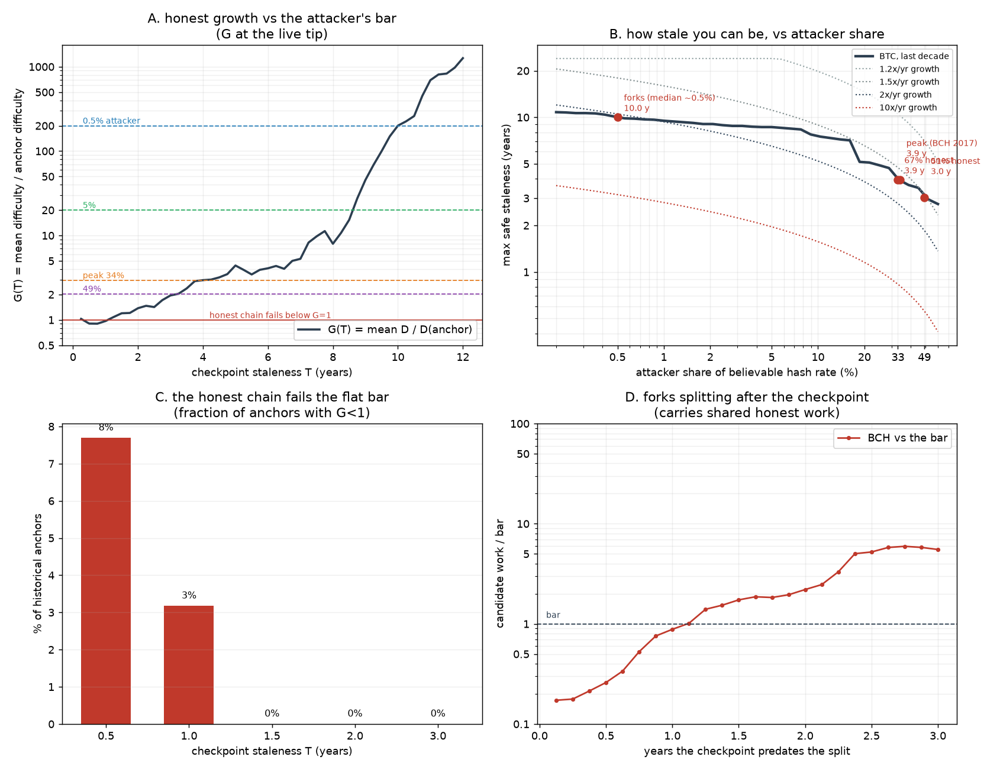
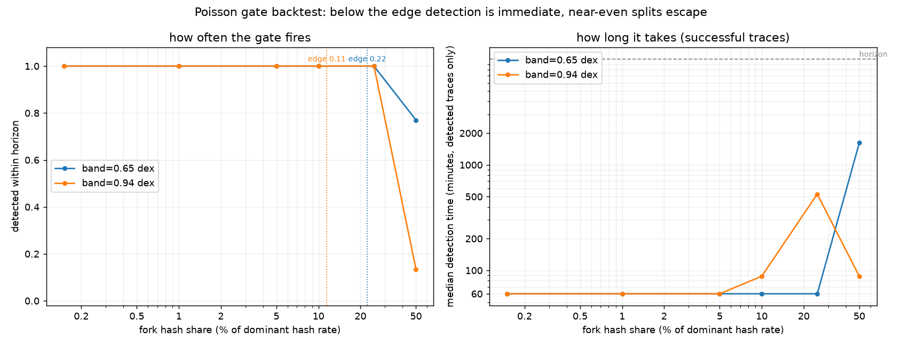

# partition-safe-ibd

A node that is network-partitioned — say, it can only reach Bitcoin Cash peers —
sees one chain and must decide whether it is the honest one.  If it isn't, the
node should not finalize.  This repo measures whether a trusted Bitcoin header
history is enough to tell, using difficulty (hash-rate) history alone.

## The rule

Accept a candidate if its work since the trusted checkpoint is at least the work
a chain running at the checkpoint's difficulty would have done:

```
W_cand  ≥  D0 · (2³²/600) · T          T = t_now − t0, from the NODE's clock
```

Everything reduces to one statistic:

```
G(T) = mean difficulty over [t0, t_now] ÷ D0
```

The honest chain clears the bar by `G(T)`; a fork holding a share `s` of
believable hash passes iff `s ≥ 1/G(T)`.  `finality.decide_flat()` implements
this, optionally with a tip-freshness check.  No fit, band or isotonic
calibration is needed — the fitted variant elsewhere in the repo is weaker and
lives in the appendix of **[resistance.md](resistance.md)**.

## How stale can the checkpoint be?

| attacker share `s` | 0.5 % | 1 % | 5 % | 33 % | 49 % |
|---|---|---|---|---|---|
| max safe staleness | 10.0 y | 9.5 y | 8.6 y | 4.0 y | 3.0 y |



Two ends to the window:

* **Above**, a big attacker; and an attacker picks the moment, so the *peak*
  non-BTC share is the honest threat model, not the median.  BCH peaked at
  **34 %** in 2017 → **~3.9 years**.  With the recent ~0.5 % share it is ~10 years.
* **Below**, availability: today the honest chain is at **0.90× the bar at a
  6-month staleness** (`G < 1`), so checkpoints younger than ~1.5 years
  occasionally refuse to finalize real Bitcoin (8 % of historical anchors at
  0.5 y, 3 % at 1 y, 0 % at ≥ 1.5 y).

Net: the usable window is roughly **1.5–4 years**.  Details in
[resistance.md](resistance.md).

## What it does not cover

* **Forks that split *after* the checkpoint.**  A fork carries the honest chain's
  work up to its split, so it does not need to mine that part.  A node
  partitioned *after* a split cannot detect it: a checkpoint from 2015–2017
  passes BCH at 1.4–6.3× the bar, and a stalled fork passes whenever the
  checkpoint predates the split by enough.  The caps above apply only to forks
  that split at or before the anchor.
* **Near-even splits.**  Once the honest chain has grown ~2× over the interval, a
  49 % fork is indistinguishable from it — the 50/50 floor of any work-based rule.
* **The clock.**  `T` and any tip-age gate come from the node's clock, not the
  headers; header timestamps only certify work.

## Findings

* **Non-BTC SHA256d hash is small.**  BCH peaked at 34 % (Aug–Oct 2017), BSV at
  2.6 %, XEC at 0.24 %; the collective median is 1.3 % over history and 0.5 %
  recently.
  
* **Asymmetric splits are caught fast.**  Below the rate edge the work gate fires
  at the first check, ≈ 1 h; a genuine 50/50 split is the residual case (it
  escapes 86 % of 7-day traces at a 0.94 dex band).
  

Bookkeeping: walk-forward coverage of the fitted variant was 100/100/94 % on
~17/8/4 independent windows (95 % lower bounds 84/69/47 %), and the earlier
"forks caught out to two years" result tested only forks that split before the
anchor — both are superseded by the flat-bar analysis above.

## Repo and running

```
finality.py          # the rules: decide_flat(), plus the fitted-band variant
forks.py             # non-BTC SHA256d hash share of Bitcoin
resistance.py        # staleness bound, availability, late-split test, figure
budget.py            # fitted-band attack budget over historical windows
chainwork.py         # fitted-band report and start-grid figure
simulate.py          # detection-latency backtest
attack_sim.py        # block-level attacker under the real retarget path
fetch.py             # cache difficulty series -> data/<chain>.json
checkpoints.txt      # trusted BTC header spine
data/  diagrams/     # cached series and generated PNGs
resistance.md        # derivations: caps, honesty thresholds, late splits
```

```sh
python3 fetch.py            # BTC offline; BCH/XEC Blockchair; BSV a public node
python3 finality.py         # flat-bar decisions, live tip and a fork at share s
python3 resistance.py       # caps, availability, late-split table + figure
python3 forks.py            # non-BTC hash share + figure
python3 simulate.py         # detection-latency backtest
python3 chainwork.py        # fitted-band report and start-grid figure
```

Install: `python3 -m venv .venv && . .venv/bin/activate && pip install matplotlib`.
Scripts print their reports without matplotlib and skip only `savefig`.
