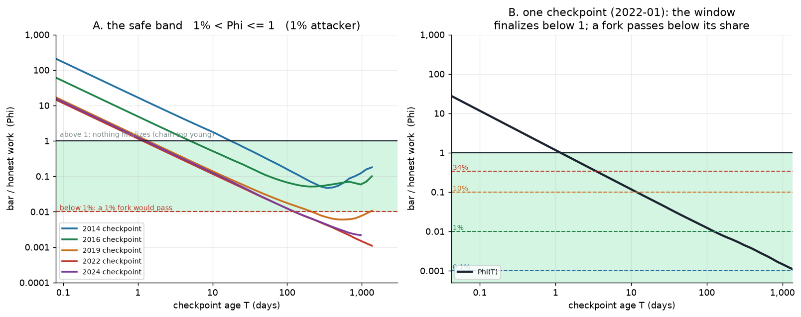

# Partition-safe IBD

**Finalizing a downloaded chain without asking peers whether it is the best one.**

A node doing initial block download trusts its peers. An eclipse, or a network
partition that leaves it talking only to a fork's peers, can feed it a chain that
is valid but not the best one — and it finds out only when it reorgs out of
transactions it had already treated as settled.

Partition-safe IBD removes that trust **for finality**. The node ships with a
**trusted header spine**: Bitcoin's real headers, hard-coded up to a checkpoint
`t0`. From the spine it knows the network's historical work rate, and so can
estimate how much work the network is doing *now*. It then refuses to finalize the
chain it is downloading until that chain proves it carried comparable work since
`t0`. The spine is fixed at compile time, so a partition cannot rewrite it, and
the bar is denominated in **work**, which has to be hashed, so an attacker cannot
forge it. The only other input is the node's own clock.

The guarantee is **finite**: it holds for years against a small attacker, not
forever. Past its horizon a node must adopt a newer checkpoint (upgrade) or fail
closed rather than finalize a chain it cannot vouch for.

## Findings

* A **fixed** bar is overtaken with age: a fork keeps mining while the bar stands
  still, so 100 blocks holds a 1% attacker for ~70 days and a 34% attacker for
  ~2 days.
* So the bar must grow too. Keep 100 blocks as a **floor** and add `T/600` blocks
  — the work a chain at the checkpoint rate would have done over the checkpoint's
  age `T` — and take the larger.
* When the age term dominates, the guarantee collapses to one condition: a fork of
  share `s` is kept out iff work per block has grown by less than `1/s` since the
  checkpoint — 100× for a 1% attacker, only ~3× for 34%. That is why the horizon
  shortens so fast, and why it is finite at all (§3.3).
* The fragile part is estimating the work of a block *now*. Over-estimating only
  delays finalization; under-estimating sinks the bar toward the fork's work, so
  the estimate may come in at most `1/s` low (§4).

## Contents

1. [The rule](#1-the-rule)
2. [Threat model](#2-threat-model)
3. [Why the bar has this shape](#3-why-the-bar-has-this-shape)
4. [Estimating current work per block](#4-estimating-current-work-per-block)
5. [Backtest](#5-backtest)
6. [Deployment](#6-deployment)
7. [Limitations](#7-limitations)
8. [Reproduce](#8-reproduce)

---

## 1. The rule

Finalize the candidate chain only if

```
c  ≥  max( 100·ρ , T/600 )
```

| symbol | meaning |
|---|---|
| `w0 = D0 · 2³²` | work of one block at the checkpoint difficulty `D0` |
| `c = C / w0` | the candidate's chainwork `C` since `t0`, in *checkpoint blocks* |
| `ρ = ŵ / w0` | estimated work of one block **now**, relative to the checkpoint |
| `T = t_now − t0` | checkpoint age, from the node's clock (seconds) |
| `600` | target seconds per block, so `T/600` is the number of blocks a chain at checkpoint work per block would have produced over `T` |

Everything is measured in checkpoint blocks, so `ρ` is dimensionless.

**Estimating `ρ`.** Fit work per block directly as a power law in chain age,
anchored at the checkpoint:

```
ρ(t0,T) = κ · ( 1 + T_y / a0 ) ^ p
```

* `T_y` is `T` in years and `a0` is the checkpoint's age in years.
* `p` is the least-squares slope of `log10(work per block)` on `log10(age)` over
  the trailing 4 years.
* `κ = 10^r ≥ 1` is the band that the same fit needed to contain its own history,
  applied upward only.

The trend is `1` at `T = 0`, and `κ` lifts it. Over-estimating `ρ` only delays
finalization. Under-estimating is the unsafe direction.

**What the two terms do.**

* `100·ρ` is the **floor**: the coinbase-maturity assumption applied to sync. The
  network already treats 100 blocks at current difficulty as out of reach, which is
  why a coinbase may be spent after 100 confirmations. Anyone who could clear this
  bar could equally revert Bitcoin's last 100 blocks, a strictly more damaging
  attack.
* `T/600` is the **age term**. A fork keeps mining while the floor stands still, so
  the bar has to grow with `T`.

The crossover is at `T* = 60 000 · ρ` seconds, about **17 h × ρ**. Because
`ρ(0) = κ` and `κ` has median 2.2 over 2014+ checkpoints, the age term takes over
after about **a day and a half** for a typical modern checkpoint, and later for an
older one (§3.4).

`t0` need not be the shipped checkpoint: any history the node already **trusts**
serves as the anchor, and a fresher anchor means a smaller, cheaper bar (§6).


## 2. Threat model

**Trusted:** the spine (compiled in, so a partition cannot alter it) and the
node's clock.

**Untrusted:** every peer.

**Attacker.** It controls the node's view of the network. It holds a fraction `s`
of the honest chain's hash rate, sustained since `t0`. It can mine a fork
privately and present it later. It cannot forge work: chainwork counts expected
hashes, so timestamp manipulation changes how many blocks a fork has, not how much
work.

**Goal.** An `s`-share fork must not be finalized before the protection horizon,
and the honest chain should be finalized promptly.

**Out of scope.** A fork that split off before `t0` (§7), and an attacker who
controls the node's clock.

The node sees only one chain, so the honest chain and an `s`-share fork are
indistinguishable except through their work.

## 3. Why the bar has this shape

### 3.1 One dimensionless quantity

Let `h(T)` be the honest chain's work since `t0`, in checkpoint blocks:

```
h(T) = G(T) · T/600        G = mean work per block over the interval, relative to w0
```

Define `Phi = bar / W_honest = max(100·ρ, T/600) / h`. Then:

* the honest chain is finalized iff `Phi ≤ 1`;
* a fork of share `s` has work `s·h` and is kept out iff `Phi > s`.

So the rule is correct exactly when `s < Phi ≤ 1`. Too low and a fork slips
through; too high and even the honest chain is denied. `Phi` generally falls as
`T` grows, so the safe band is a **window in staleness** — with the caveat that
the floor can re-bind later and raise it again (§3.4). Controlled overshoot of `ρ`
(`ρ > 1`) raises `Phi`: it costs availability, never safety.



### 3.2 A fixed bar is overtaken

Both the honest chain and an `s`-fork accumulate work in proportion to the elapsed
interval, `h_honest ≈ G · T/600` and `h_fork = s · h_honest` (all in checkpoint
blocks), so a **constant** bar `100·ρ` is crossed by the fork once
`s · G · T/600 ≥ 100·ρ`:

```
T_hi(s) ≈ 60 000 · ρ / (G · s)   seconds
```

`T` sits in the numerator, so **no constant bar can hold**. A 1% attacker clears
the fixed bar in about 70 days, and a 34% attacker in about 2 days.


### 3.3 The age term, and what its security actually depends on

When `T/600` is the larger term, `Phi = (T/600) / (G · T/600) = 1/G`. The age
bar's guarantee therefore reduces to a single condition:

> A fork of share `s` is kept out as long as `G < 1/s`, meaning the network's
> average work per block has not grown by a factor of `1/s` relative to the
> checkpoint.

That is 100× for a 1% attacker and only about 3× for a 34% attacker, which is why
the second horizon is so much shorter. The same expression shows the cost: the
honest chain is denied whenever `G < 1`, in a drawdown or under short-interval
block-count variance. It is also biased by construction — it prices a block at the
*checkpoint's* work, which underestimates the honest chain whenever difficulty has
grown. That is the source of the finite horizon, and why the checkpoint must
eventually be refreshed.

### 3.4 When the estimator matters

`ρ` enters `Phi` directly, so the estimate may come in at most `1/s` **low**: 100×
for a 1% attacker, about 3× for 34%. It binds whenever `100·ρ > T/600`, i.e. while
`T < 60 000·ρ`. For a modern checkpoint that is a day or two (§1). For an older one
the pattern is worse. `ρ` grows faster than `T`, so the floor yields for a while,
the age term takes over, and then the floor **re-binds**: from a 2014 checkpoint
the age term dominates from about 30 days to about a year, and from two years out
`100·ρ` is the larger term again. Since `Phi` is then rising, the honest chain can
be denied at long staleness even though it cleared the bar earlier. That is the
finite horizon in another guise, and it is why §7 insists on checkpoint refresh.

## 4. Estimating current work per block

Work per block is described far better by a power law in age than by an
exponential. Over 2011–2026 a log-log fit gives R² 0.96 against 0.83 for a
straight line (2014+: 0.97 against 0.90). The realised growth rate *decays* with
age — from roughly 900×/yr at the 2013 peak to about 1.5×/yr in the 2020s — and
that decay (`rate ∝ 1/age`) is the power-law signature. A constant-rate
exponential cannot follow it.

**Fit details.**

* Fitting work instead of difficulty is the same line, since
  `log10 w = log10 D + log10 2³²` shifts every point by a constant. The slope,
  residuals and band are unchanged, and the `2³²` factor and the separate `y0`
  anchor drop out.
* The trend is anchored so it equals `1` at `t0`.
* The band `κ` is the largest relative departure the fit needed to contain its own
  fitting window, applied one-sided, so errors only delay finalization.
* `κ` is not small: median 2.2 over 2014+ checkpoints, 90th percentile 35, over 50
  on the oldest. That is a delay, not an unsafety, but it is why the first bar
  costs days rather than hours (§6).

**Accuracy.** `log10(ŵ / w_true)` in dex on 2014+ checkpoints (2.0 = 100×). The
table gives the 5th percentile, median and 95th percentile at each horizon.

| estimator | 30 d | 90 d | 1 y | 2 y |
|---|---|---|---|---|
| flat (no growth) | −0.11 / −0.03 / +0.02 | −0.34 / −0.07 / +0.04 | −0.84 / −0.24 / −0.04 | −1.45 / −0.49 / −0.20 |
| exponential, 3 y trailing growth | −0.04 / +0.01 / +0.11 | −0.08 / +0.03 / +0.31 | −0.19 / +0.20 / +1.04 | −0.18 / +0.51 / +1.96 |
| log-log OLS, 4 y, unanchored | −1.08 / +0.04 / +0.62 | −1.15 / +0.05 / +0.69 | −0.78 / +0.04 / +0.96 | −0.71 / +0.15 / +1.05 |
| **power law, 4 y, anchored + own band** | **+0.12** / +0.33 / +1.68 | **+0.13** / +0.35 / +1.75 | **+0.12** / +0.52 / +2.23 | **+0.02** / +0.76 / +2.60 |

* The **flat** guess under-shoots whenever difficulty grows, the only unsafe
  direction.
* The **unanchored OLS** is poor even at 30 days, because its fitted value at `t0`
  sits far from the work actually in force there. Anchoring fixes that.
* The **recommended** estimator has a 5th percentile above zero at every horizon,
  so on this sample it does not under-shoot. The price is over-shoot, which only
  delays finalization. That is an **in-sample** claim (§7).
* A **fixed** safety multiple (say ×50) must be sized for the worst era and
  over-shoots everywhere else; a band that reflects how far the line actually
  wandered calibrates itself per checkpoint.


In the bottom panel of `plaw_band.png`, each point is
`100 · ρ(t) · w0 / w_true(t)`: the bar in blocks at the work actually in force,
for a node that starts syncing at `t`. `100` is a perfect estimate, above it is a
delay, and below it is the unsafe direction. Older fits sit far above 100 and
climb the further back they start, which is the finite horizon in block terms. The
most recent fit (2023) dips below 100 — down to about 76 blocks some three years
out — so "the 5th percentile never under-shoots" is a statement about the sample
average, not a promise for any single checkpoint (§7).

**Window length.** The one free choice. A shorter window tracks the current
regime and over-shoots less. A longer one is more conservative. The 5th percentile
/ median at 2 years ahead:

| window | 2 y | 3 y | 4 y | 5 y | full history |
|---|---|---|---|---|---|
| p5 / p50 (dex) | −0.34 / +0.27 | −0.06 / +0.57 | **+0.02 / +0.76** | +0.15 / +0.88 | +1.32 / +1.75 |

Every window is inside the 34% tolerance (about 0.5 dex), so the choice trades
delay, not safety. **4 years** is where the low tail first clears zero, and 3
years is the lower-delay option if a slightly negative tail is acceptable. This
choice was tuned on the same sample it is evaluated on (§7).


## 5. Backtest

**Scope.** 481 two-week BTC samples, about 340 of them from 2014 onward (the
post-ASIC regime). Horizons overlap, so read the rates as descriptive, not as
independent trials.

**Protection horizon.** Median over six yearly checkpoints, 2014–2024:

| rule | s = 0.1% | s = 1% | s = 10% | s = 34% |
|---|---|---|---|---|
| fixed 100 (`ρ = 1`) | 1.3 y | 0.2 y | 6 d | 2 d |
| **age bar** | **5.2 y** | **6.6 y** | **2.4 y** | **1.5 y** |
| log-log OLS + 2 sd | never | 0.2 y | 11 d | 3 d |

Read this table with care. At `s = 0.1%` five of the six checkpoints never cross
the age bar before the data ends, so that cell is a single checkpoint (2014,
5.2 y). At `s = 1%` four are censored, leaving 3.4 y and 6.6 y, and the cell is
their median. That is also why the age-bar row is not monotone in `s`: a weaker
attacker should never be easier to stop, and the underlying data does not say it
is — the table just does not have the sample to show it. Treat it as a sketch of
the shape, not a guarantee.

The "fixed 100" row is the clock-free variant `100 · w0` (`ρ = 1`); the security
table below uses a capped-growth estimate, which is why its numbers differ
slightly.


### Security: fraction of checkpoints a fork passes

Quarterly 2014+ checkpoints (n = 50, fewer at long `T`).

| rule | 1% fork, 90 d | 1% fork, 1 y | 34% fork, 90 d | 34% fork, 1 y | 34% fork, 2 y |
|---|---|---|---|---|---|
| fixed 100 (`exp-2y-cap2x`) | **96%** | **100%** | 100% | 100% | 100% |
| age bar | 0% | 0% | 0% | 11% | 40% |
| full rule `max(100·ρ, T/600)` | 0% | 0% | 0% | 11% | 26% |

The age term asks `T/(60 000·ρ)` times more work than 100 current blocks: 43× at
30 days and 526× at a year (both at `ρ = 1`).


### Availability: fraction of checkpoints that deny the true chain

Same grid.

| rule | 1 d | 7 d | 30 d | 90 d | 1 y | 2 y |
|---|---|---|---|---|---|---|
| fixed 100 | 0% | 0% | 0% | 0% | 0% | 0% |
| age bar | 30% | 30% | 28% | 16% | 4% | 0% |
| full rule | 94% | 50% | 38% | 16% | 4% | 5% |

The age-bar and fixed-100 rows are `exp3_backtest.py`. The full-rule rows are the
same backtest evaluated with `model.bar`, and are not yet printed by that script
(§7).

The full rule is much more expensive than the age bar at short staleness, because
the 100-block floor binds until `T ≈ 60 000·ρ`. It buys nothing in security there —
the age bar is already safe at short `T` — so the floor is purely a delay at those
horizons. It does buy security later: 26% against 40% for a 34% fork at 2 years.


### The trade

The fixed bar buys availability at every staleness by giving up security after
days to weeks. The age bar gives up availability early and stays secure for years.
Since the floor only re-binds at long staleness, the full rule is best read as the
age bar with a 100-block floor for the first day or two, and it is the better
operating point because delayed finalization is acceptable.

## 6. Deployment

1. **Ship a spine** to `t0`; this fixes `w0` and the unit.
2. **Estimate current work**: `ρ = κ·(1 + T_y/a0)^p`, the anchored 4-year power law
   with its band.
3. **Evaluate finality**: finalize iff `c ≥ max(100·ρ, T/600)`.
4. **Re-anchor**: each batch that clears the bar becomes the new trusted anchor,
   so the next bar is estimated against a fresh tip and falls back toward 100
   blocks.
5. **Refresh or fail closed** past the horizon.

**`t0` need not be the shipped checkpoint.** Any history the node trusts can be the
anchor, including a chain it finalized in an earlier session:

* **Returning node.** It anchors on its own finalized chain, so `T` is small and
  the bar is cheap from the first second, regardless of how old the binary is.
* **Within one sync.** Step 4 applies recursively. The figures' block counts are
  the *first* bar only; they shrink as finalization proceeds. Where the sample runs
  long enough to see it, that first bar takes a median 5.4 days to clear — 15 days
  for 2014–18 checkpoints, 1.1 days for 2022+ ones. A handful of the most recent
  checkpoints never clear it inside the data at all, which is right-censoring, not
  a denial.

Only a **first-ever sync**, or one whose stored chain was rolled back, falls back
on the hard-coded checkpoint and pays the full stale-checkpoint premium.

**When the checkpoint is too old.** No work-since-`t0` rule survives arbitrarily
long staleness, since each term eventually weakens and the power-law floor stops
falling monotonically. A horizon of a few years is only usable if nodes upgrade on
roughly that cadence. That is a deployment assumption, not something this study
measured.

## 7. Limitations

1. **Late split.** A checkpoint older than the fork's split point hands the fork
   its prefix for free. No work-since-`t0` rule helps; checkpoint freshness is the
   only fix.
2. **The clock.** `T` comes from the node's clock, and header timestamps only
   certify work. A fixed bar at checkpoint work per block (`100·w0`, i.e. `ρ = 1`)
   is clock-free, which is its one real advantage over this rule.
3. **The 100.** It is a protocol constant (coinbase maturity), not a tuned
   parameter, and it prices a *reversal*, not a *partition*. The two do not scale
   the same way in `T`, so treat it as a floor, not the whole bar.
4. **Regime dependence.** The estimator extrapolates the trailing four years of
   growth and is validated on 2014+ checkpoints only. A fit to 2012–13 history
   under-shoots the ASIC transition badly (roughly 13,000× difficulty over
   2013–2015), and a comparable future discontinuity would break it the same way.
5. **Evaluation.** About 340 overlapping samples, with no out-of-sample test. The
   4-year window was chosen where the low tail first clears zero on the same data
   it is then evaluated on, so "the 5th percentile never under-shoots" is
   in-sample. The 2-year p5 is only +0.02 dex, and at least one individual fit
   (2023) runs under the truth by about 25% (§4).
6. **Horizon and full-rule tables are thin.** The horizon table uses six
   checkpoints, 2–5 of them censored at small `s`; re-running on every 2014+
   checkpoint would give a usable distribution. `exp3_backtest.py` also evaluates
   the age bar alone — the full-rule rows in §5 come from the same model but are
   not printed by that script.
7. **`Phi` is not monotone in `T`.** The fixed term can grow again after the age
   term has dominated, so `Phi` can dip below 1 and later rise above it: in 86 of
   339 2014+ checkpoints the bar at the end of the sample is above the honest
   chain's work even though it was below it earlier. `finalize_time` only tests the
   endpoint, so its "never" cells can hide an earlier crossing.
8. **`1/s` floor.** Even a perfect bar cannot separate a fork once `s ≥ Phi`, so
   very small `s` at long staleness is unattainable.

## 8. Reproduce

```sh
python3 -m venv .venv && .venv/bin/pip install matplotlib numpy
cd research && ../.venv/bin/python run_all.py     # writes research/figures/*.png
```

| script | what it shows |
|---|---|
| `research/model.py` | spine, work, estimators, `bar`, `Phi`, `finalize_time` |
| `research/exp1_window.py` | `Phi(T)`, the safe band, the staleness window |
| `research/exp2_estimator.py` | estimator error table (§4) |
| `research/exp3_backtest.py` | availability and security rates, `Phi` heatmap |
| `research/exp4_horizon.py` | protection horizon `T_hi(s)` |
| `research/exp5_bars.py` | concept and "why the bar must grow" diagrams |
| `research/exp6_band.py` | the self-calibrated band, projected forward |
| `research/exp7_window.py` | trend and error vs fit window |

Experiments and lab notebook: [`research`](research).
