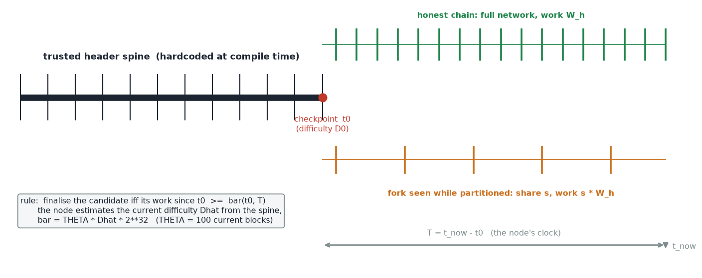
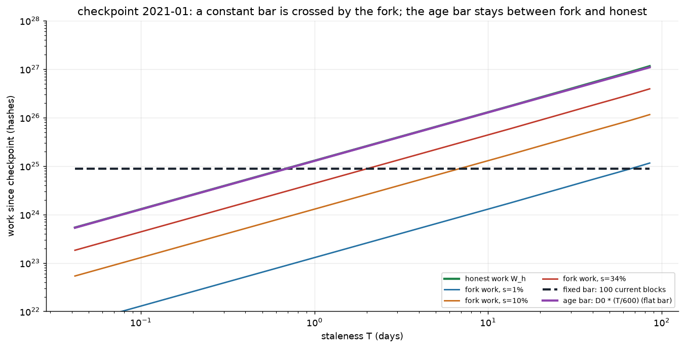
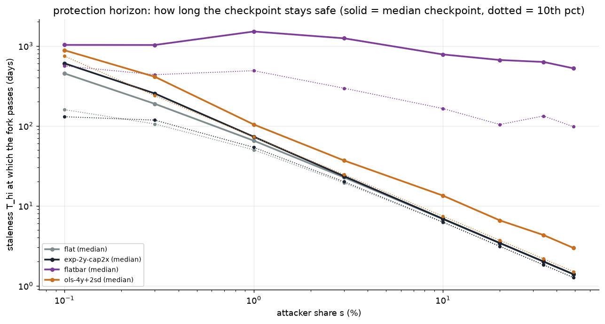
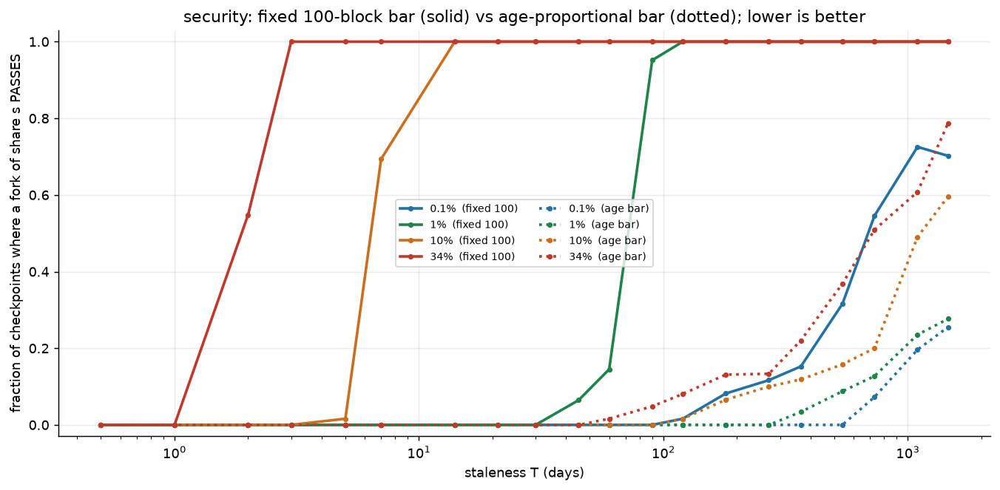
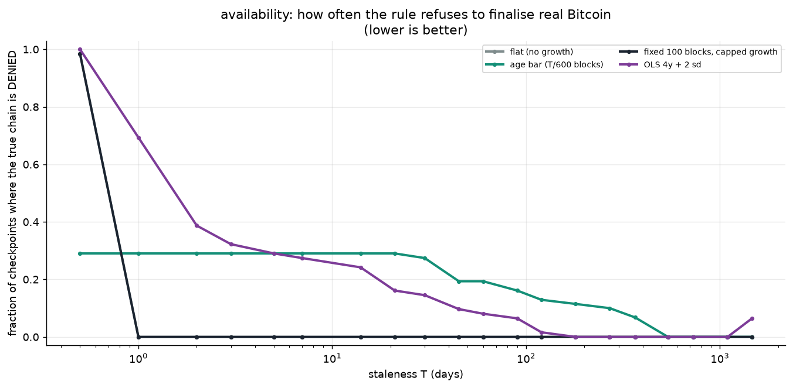
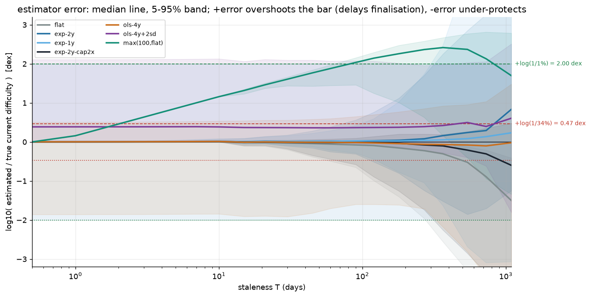

# Partition-safe IBD — can "100 blocks at current difficulty" finalise a partitioned node?

A node ships with a trusted Bitcoin header spine that ends at a **compile-time
checkpoint `t0`**. When it wakes up at wall-clock `t_now` it may be
network-partitioned, so it cannot tell whether the chain it is offered is the
best chain. The proposal: using the truth it already has (`t ≤ t0`), estimate the
**current** difficulty `D̂`, and refuse to finalise a candidate unless it carries
at least

```
bar(t0,T) = THETA · D̂ · 2³²          THETA = 100 blocks,   T = t_now − t0
```

of work since the checkpoint — the work of 100 current blocks, the same bound
that makes a coinbase spendable after 100 confirmations.

This folder is the write-up. The experiments live in [`../research`](../research).

---

## TL;DR

* The **threat model is right** (partition resistance is a *work* question) and
  the **estimator is the hard part** — but a **fixed 100-block threshold is the
  wrong shape**.
* A forked minority's work grows with the elapsed interval (`s · W_h`), so a
  constant bar is overtaken. On real history the 100-block rule stops a 1%
  attacker only for ~70 days and a 34% attacker for ~2 days
  ([`horizon.png`](diagrams/horizon.png)).
* **The margin must grow with staleness.** To keep a share `s` out at staleness
  `T` the node must demand at least `m ≈ s · G · T / 600` blocks of
  current-difficulty work — *proportional to T*. The natural choice is the
  age-proportional bar `D0 · T/600 · 2³²` (the "flat bar"), which is `T/60000`
  times stricter for `T > 17 h` and keeps forks out for **years instead of days**
  ([`bars.png`](diagrams/bars.png), [`security.png`](diagrams/security.png)).
* The 100-block idea survives as a **floor** and as the correct intuition for
  *why* the checkpoint must be fresh — the recommended rule is the flat bar with
  a 100-block floor.
* Whatever the bar, the node must estimate difficulty to within a factor `1/s`:
  empirically 2-week-to-2-year extrapolation is off by **0.2–4 dex**, so the
  method can separate a 1% attacker for months but a 34% attacker only for days
  ([`estimator.png`](diagrams/estimator.png)).

---

## 1. The setup



The node holds a spine of real headers to `t0` (one per retarget period is
enough). A candidate that descends from the spine is accepted iff its work since
`t0` clears the bar. The node sees only one chain, so the honest chain and an
`s`-share fork are indistinguishable except through their work.

Work is measured in hashes: one block at difficulty `D` costs `D·2³²`.
Everything reduces to a single dimensionless number,

```
Phi(t0,T) = bar / W_honest = THETA · D̂ · 2³² / W(t0, t0+T)
          = 600 · THETA · rho / (G · T)                     T in seconds

G(T)   = mean difficulty over [t0,t0+T] / D0      (how much difficulty grew)
rho    = D̂ / D0                                   (the node's estimate vs its start)
```

* the **honest** chain finalises iff `Phi ≤ 1`;
* a fork of hash share `s` is kept out iff `Phi > s`.

So the rule is correct exactly on the band

```
s  <  Phi(t0,T)  ≤  1                  (safe band)
```

Too small and a fork slips through; too large and even the honest chain is
denied. `Phi` falls as `T` grows, so the band is a **window in staleness**
([`window.png`](diagrams/window.png)). Controlled overshoot of `D̂` (`rho>1`)
raises `Phi`: it costs availability, never safety — as the brief says.

## 2. Why a fixed bar is overtaken



The honest chain and an `s`-fork both accumulate work in proportion to the
elapsed interval,

```
W_honest(T) ≈ (T/600) · G · D0 · 2³²          (T/600 = target blocks in the interval)
W_fork(T)   =  s · W_honest(T)
```

so a **constant** bar `100·D̂·2³²` is crossed by the fork once

```
s · W_honest(T) ≥ 100 · D̂ · 2³²     ⟺     T ≥ T_hi(s) ≈ 600 · THETA · rho / (G · s).
```

The protection horizon is finite and shrinks with the attacker's share:

| checkpoint, median over 2011+ | s=0.1% | s=1% | s=10% | s=34% |
|---|---|---|---|---|
| fixed 100-block (capped growth) | 1.7 y | 0.2 y | 6 d | 2 d |
| **age-proportional (flat bar)** | **5.2 y** | **3.4 y** | **2.4 y** | **1.5 y** |
| conservative OLS + 2 sd | 2.5 y | 0.3 y | 15 d | 4 d |



Equivalently, solving `Phi > s` for the demanded number of blocks `m`:

> **To exclude a share-`s` fork at staleness `T`, the node must demand at least
> `m(T) ≥ s · G · T / (600 · rho) ≈ s · T/600` blocks of current-difficulty
> work — a fraction `s` of the blocks mined in the interval.**

A constant `m = 100` satisfies this only for `T ≤ 60000 · rho/(G s)`. The
principle the brief calls "adjust the margin based on how far in the past"
is therefore not optional: **the margin has to scale with `T`.**

## 3. The age bar is far stronger, and what it costs

Set `m(T) = T/600` (the "flat bar": work at checkpoint difficulty). It asks
`T/60000` times more work than 100 fixed blocks — 43× at 30 days, 526× at a year.



| fraction of historical checkpoints a fork PASSES | 1% fork | 34% fork |
|---|---|---|
| fixed 100-block, at 90 d | **95%** | 100% |
| fixed 100-block, at 1 y | **100%** | 100% |
| age bar, at 90 d | 0% | 5% |
| age bar, at 1 y | 3% | 22% |
| age bar, at 2 y | 13% | 51% |

The cost is availability — the flat bar denies the true chain in drawdowns
(`G<1`) and under short-interval block-count variance:



| fraction of checkpoints that DENY the true chain | 1–7 d | 30 d | 90 d | 1 y | 2 y |
|---|---|---|---|---|---|
| fixed 100-block (capped growth) | 0% | 0% | 0% | 0% | 0% |
| age bar (flat) | 29% | 27% | 16% | 7% | 0% |

So it is a clean trade: **the fixed bar buys availability at all staleness by
giving up security after days-to-weeks; the age bar gives up a little
availability early and stays secure for years.** Because delayed finalisation is
acceptable (§1), the age bar is the better operating point, and the 100-block
rule is best used as its floor:

```
bar(T) = max( 100 · D̂ · 2³² ,  D0 · 2³² · T/600 )
```

## 4. The estimator must be right to a factor `1/s`

Whatever the bar's shape, `rho` enters `Phi` directly. To place the bar between
the fork (`s·W_h`) and the honest chain (`W_h`) the estimate must be correct to
within `log10(1/s)` — 2.0 dex for a 1% attacker, only 0.47 dex for 34%.



| 5–95% spread of `log10(D̂/D_true)` | 30 d | 90 d | 1 y | 2 y |
|---|---|---|---|---|
| flat (no growth) | 0.2 | 0.7 | 2.5 | 3.8 |
| capped exponential (2 y, ≤2×/yr) | 0.2 | 0.7 | 2.5 | 3.7 |
| OLS log-log, 4 y | 2.5 | 2.3 | 3.1 | 4.5 |
| OLS log-log, 4 y + 2 sd | 2.1 | 2.1 | 2.3 | 2.7 |

Reading: the **flat** estimate under-shoots whenever difficulty grows (the only
unsafe direction), the **capped exponential** keeps the error to ~0.7 dex for
three months (inside the 1% tolerance), and the **OLS trend** is poor even at one
day because the trend value at `t0` can sit far from actual difficulty. Adding a
conservative slack (`+2 sd`) guarantees overshoot — safe, but it delays the
honest chain and hits the 34% tolerance (0.47 dex) almost immediately.

## 5. Real forks, and the late-split bound

BCH/BSV/XEC carry Bitcoin's genuine prefix work, then their own. (candidate work / bar; `<1` = caught)

| fork, checkpoint | shared prefix | age bar | fixed 100 | capped exp |
|---|---|---|---|---|
| BCH, 2017-03 | 6% | **0.86** | 4.3e3 | 5.9 |
| BCH, 2017-08 (at split) | 0% | **0.44** | 2.1e3 | 3.8 |
| BCH, 2018-01 | 0% | **0.22** | 996 | 2.4 |
| XEC, 2020-01 | 98% | **0.16** | 554 | 5.3 |

The age bar catches every real fork from a checkpoint near or after the split;
the fixed 100-block bar never does, and the capped-exponential estimator is too
noisy. But **if the checkpoint predates the split**, the shared prefix alone
clears either bar (BCH at a 2014-12 checkpoint = 8.95× the age bar) — the
late-split bound of the prior analysis. A sound checkpoint must post-date any
live fork.

## 6. Recommended rule

1. Ship a spine to `t0`; anchor `D0`.
2. Estimate current difficulty with a **growth-capped** method
   (`D̂ = D0 · min(g,2)/yr ^ (T/1yr)`, `g` from the trailing 2 years) — bias up.
3. Finalise iff

   ```
   W_candidate(t0 → tip)  ≥  max( 100 · D̂ · 2³² ,  D0 · 2³² · T/600 )
   ```

   i.e. **100 current blocks and at least the work a checkpoint-difficulty chain
   would have done.** For `T > ~17 h` the second term dominates: the rule is the
   flat bar, with the 100-block term as the first-hours floor.
4. Refresh the checkpoint. The protection horizon is finite (`T_hi(s)` above);
   a stale binary is only safe because it *also* demands more work, and no
   work-since-`t0` rule survives an arbitrarily long staleness.

## Caveats

* **Late split.** A checkpoint older than a fork split hands the fork its prefix
  for free; no work-since-`t0` rule can help. Checkpoint freshness is the fix.
* **The clock.** `T` and any tip-age gate come from the node's clock; header
  timestamps only certify work. The pure fixed bar with `D̂=D0` is clock-free —
  its one genuine advantage.
* **`THETA`.** 100 is a *reversal* cost, not a *partition* cost; the two do not
  scale the same way in `T`. Treat 100 as a floor, not the whole bar.
* **Data.** 481 two-week BTC samples; fork series are 25/25/16 points, so the
  fork table is illustrative.
* **`1/s` floor.** Even a perfect bar cannot separate a fork once `s ≥ Phi`; the
  accuracy requirement makes very small `s` at long staleness unattainable.

## Reproduce

```sh
python3 -m venv .venv && .venv/bin/pip install matplotlib
cd research && ../.venv/bin/python run_all.py     # writes research/figures/*.png
```

| script | what it shows |
|---|---|
| `research/model.py` | spine, work, estimators, `bar`, `Phi`, `finalize_time` |
| `research/exp1_window.py` | `Phi(T)`, the safe band, the staleness window |
| `research/exp2_estimator.py` | estimator error vs staleness, tolerance lanes |
| `research/exp3_backtest.py` | availability + security rates, `Phi` heatmap |
| `research/exp4_forks.py` | protection horizon, real forks, late splits |
| `research/exp5_bars.py` | concept and "why the bar must grow" diagrams |
