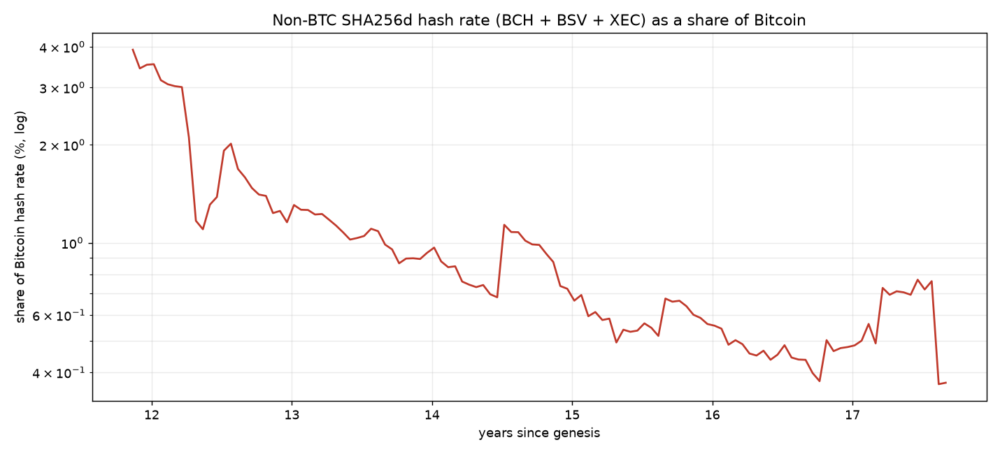

# Partition resistance: how stale can the checkpoints be?

A node that is network-partitioned sees only the attacker's fork, so it must
decide from a trusted checkpoint alone.  This note derives the maximum checkpoint
staleness that is safe, as a function of **how much hash rate the attacker
controls**, and compares it to what non-BTC forks have actually held.

Notation: the trusted checkpoint is at time `t0` with difficulty `D0`; the node's
clock reads `t_now`; `T = t_now − t0` is the staleness (seconds).  Hash rate
is `H = D · 2³²/600`, so work over an interval is `∫ H dt`.

## 1. The rule

The node accepts a candidate if the candidate has done at least the work a chain
running at the *anchor difficulty* would have done (README §2; `finality.py`):

```
W_cand  ≥  W_const           W_const = D0 · (2³²/600) · T
```

(`W_const` is the constant-difficulty expectation — the checkpoint's difficulty
held flat across the interval.)

The honest chain's real work is

```
W_real = ∫ D(t)·(2³²/600) dt = G(T) · W_const
G(T)   = (1/T) ∫ D(t)/D0 dt =  mean difficulty over [t0, t_now] ÷ D0
```

`G(T) ≥ 1` always in practice: honest difficulty grows, so the real chain clears
the constant-difficulty bar with margin `G(T)`.

## 2. The attacker

An adversary holding a fraction `s` of believable hash rate can produce at most
`s · W_real` over the interval — mining continuously, since timestamps certify
work and cannot manufacture it.  The fork passes iff

```
s · W_real ≥ W_const · 10^(−b)
⟺  s ≥ 10^(−b) / G(T)
```

with `b ≥ 0` the band that lets a candidate sit below the expectation.  The
maximum safe staleness for a given `s` therefore solves

```
G(T*) = 10^(−b) / s          (b = 0 for the conservative rule)
```

So the whole question reduces to one statistic: **how much has average difficulty
grown over the stale interval**.  A node can tolerate staleness up to the point
where `mean(D)/D0` reaches `1/s`.

## 3. Closed form

If difficulty grows exponentially at `g` ×/year, `D(t) = D0·e^{kt}`, `k = ln g`:

```
G(T) = (e^(kT) − 1) / (kT)
```

and `T*` solves `G(T*) = 1/s`.  Sensitivity to the growth rate (with `b = 0`):

| attacker share `s` | 1.0×/yr | 1.2×/yr | 1.5×/yr | 2×/yr | 10×/yr |
|---|---|---|---|---|---|
| 0.5 % | ∞ | ∞ | 18.0 y | 10.5 y | 3.2 y |
| 2 % | ∞ | 31.0 y | 13.9 y | 8.1 y | 2.5 y |
| 5 % | ∞ | 24.8 y | 11.1 y | 6.5 y | 2.0 y |
| 33 % | ∞ | 10.5 y | 4.7 y | 2.8 y | 0.8 y |
| 49 % | ∞ | 7.1 y | 3.2 y | 1.9 y | 0.6 y |

No growth (`g = 1`) never breaks the rule: `G = 1`, so only a chain doing the
full work passes.  Fast growth is what opens the hole.

## 4. Empirical caps (Bitcoin, the decade to 2026)

Using the actual BTC series (`finality.py`), `T*` = first staleness at which
`G(T) ≥ 1/s`:

| attacker share `s` | 0.5 % | 1 % | 2 % | 5 % | 10 % | 20 % | 33 % | 49 % |
|---|---|---|---|---|---|---|---|---|
| max staleness | 10.0 y | 9.5 y | 9.0 y | 8.6 y | 7.6 y | 5.1 y | 4.0 y | 3.0 y |

These are flatter than the `2×/yr` column because the decade's *average* growth
was slower than 2×/yr; they are steeper than `1.5×/yr` late on, because the
2017–2019 ramp sits inside the longer windows.

## 5. How much hash non-BTC forks actually held

Measured fork-aware and from realized block times (raw difficulty ratios are
misleading: at a fork the difficulty is inherited, and BCH/BSV shared a chain
until Nov 2018):



| chain | peak | when |
|---|---|---|
| BCH | **32.3 %** | 2017-08-01 → 2017-10-28 (EDA era) |
| BSV | 2.5 % | 2019-11 |
| XEC | 0.25 % | 2021 |

Collective (BCH+BSV+XEC): median **1.2 %** over full history, **0.5 %** in the
last two years; work-weighted median **0.56 %**; mean over full history 3.75 %,
but only 0.56 % over the last three years.  The peak is a single ~3-month EDA
spike; the typical level is ~0.5 %.

## 6. Three honesty thresholds

Let `s = 1 − honesty` be the largest hash share that could be adversarial.

| case | honest BTC hash | adversarial share `s` | max staleness |
|---|---|---|---|
| 1. forks only | 100 % (all BTC honest) | ~0.5 % (fork median), up to a few % | **~9–10 y** |
| 2. 51 % honest | just over half | 49 % | **3.0 y** |
| 3. 67 % honest | two thirds (selfish-mining bound) | 33 % | **4.0 y** |

Case 1 is the "the only hash that can attack is the non-BTC forks" world: with
the measured median share that buys ~ten years, and even a 5 % fork buys ~8.6.

Cases 2 and 3 assume the attacker is not limited to non-BTC hash and can command
a chunk of Bitcoin's own: at 51 % honesty the cap collapses to ~3 years, at the
67 % selfish-mining bound to ~4.  (49 % gives a *shorter* cap than 33 % because it
needs less difficulty growth to clear the bar.)

## 7. The floor

`G` passes 2 after roughly three years at observed growth, so once the honest
chain has grown ~2× over the stale interval a **49 % fork is indistinguishable
from no fork at all** — `s·G ≥ 1`.  This is the 50/50 problem of any work-based
rule: no timestamp or difficulty check can separate a near-even split once the
honest chain's work is only ~2× the attacker's.  Every entry in the 33–49 % rows
is really this floor, not a property of the statistic.

## 8. Caveats

* **Growth-rate dependence.**  The caps are set by `mean(D)/D0`, not by age.  A
  future decade growing faster than this one shortens every cap; §3's table is
  the transfer function.
* **Constant-difficulty rule.**  These caps are for the flat bar (`b = 0`).  A
  fitted-trend bar lets the attacker in through the *band* it needs for
  downward breaks (`s ≥ 10^(−g−b)`), so it is weaker, not stronger, despite
  raising the average bar.
* **`s` is a budget, not a law.**  Non-BTC hash is a reference, not a bound: the
  attacker may rent SHA256d hash or divert Bitcoin miners.  Renting a given
  share is a cost question (see the cost figures in the README), not a share
  bound.
* **Persistent share.**  The derivation assumes the attacker's share is roughly
  constant over the interval; a share that peaks mid-interval is bounded by its
  work-weighted average, which is what §2 uses.
* **Timestamps.**  `T` is the node's clock, so a fork cannot shorten the interval;
  header timestamps only certify work.
