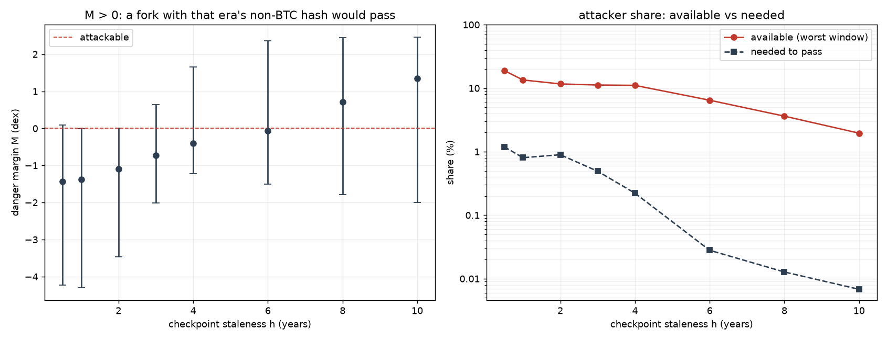
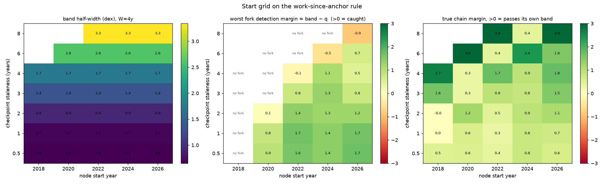

# Partition resistance: how stale can the checkpoints be?

A node that is network-partitioned sees only one chain, so it must decide from a
trusted checkpoint alone.  This note derives the maximum checkpoint staleness
that is safe as a function of **how much hash rate the attacker controls**, and
compares it to what non-BTC forks have actually held.

Notation: the trusted checkpoint is at time `t0` with difficulty `D0`; the node's
clock reads `t_now`; `T = t_now − t0` is the staleness (seconds).  Hash rate is
`H = D · 2³²/600`, so work over an interval is `∫ H dt`.

## 1. The rule

The **flat bar**: accept a candidate iff it has done at least the work a chain
running at the *anchor difficulty* would have done.

```
W_cand  ≥  W_const           W_const = D0 · (2³²/600) · T
```

`W_const` is the constant-difficulty expectation — the checkpoint's difficulty
held flat across the interval.  `finality.decide_flat()` implements this;
the fitted-trend rule elsewhere in the repo is a weaker variant (§10).

The honest chain's real work is

```
W_real = ∫ D(t)·(2³²/600) dt = G(T) · W_const
G(T)   = (1/T) ∫ D(t)/D0 dt =  mean difficulty over [t0, t_now] ÷ D0
```

`G` is the statistic everything turns on.  It is *usually* ≥ 1, but not always
(§6): in a drawdown the honest chain itself falls below the bar.

## 2. The attacker

An adversary holding a fraction `s` of believable hash rate can produce at most
`s · W_real` over the interval — mining continuously, since timestamps certify
work and cannot manufacture it.  The fork passes iff

```
s · W_real ≥ W_const · 10^(−b)   ⟺   s ≥ 10^(−b) / G(T)
```

so the maximum safe staleness solves `G(T*) = 10^(−b) / s` (`b = 0` for the flat
bar).  The whole question reduces to one statistic: **how much average difficulty
has grown over the stale interval**.  No growth never breaks the rule (`G = 1`,
only a chain doing the full work passes); growth is what opens the hole.

## 3. Closed form

For exponential difficulty growth at `g` ×/year, `D(t) = D0·e^{kt}`, `k = ln g`,
`G(T) = (e^{kT} − 1)/(kT)`, and `T*` solves `G(T*) = 1/s`.  Generated by
`resistance.py`:

| attacker share `s` | 1.0×/yr | 1.2×/yr | 1.5×/yr | 2×/yr | 10×/yr |
|---|---|---|---|---|---|
| 0.5 % | never | 40.0 y | 18.0 y | 10.5 y | 3.2 y |
| 2 % | never | 31.0 y | 13.9 y | 8.1 y | 2.5 y |
| 5 % | never | 24.8 y | 11.1 y | 6.5 y | 2.0 y |
| 33 % | never | 10.5 y | 4.7 y | 2.8 y | 0.8 y |
| 49 % | never | 7.1 y | 3.2 y | 1.9 y | 0.6 y |

## 4. Empirical caps (Bitcoin, the decade to 2026)

`T*` = first staleness at which `G(T) ≥ 1/s`, from the actual BTC series:

| attacker share `s` | 0.5 % | 1 % | 2 % | 5 % | 10 % | 20 % | 33 % | 49 % |
|---|---|---|---|---|---|---|---|---|
| max staleness | 10.0 y | 9.5 y | 9.0 y | 8.6 y | 7.6 y | 5.1 y | 4.0 y | 3.0 y |


**A. the growth functional `G(T)` and the attacker's bar `1/s`** — each crossing is
that attacker's maximum safe staleness, and the red line at `G = 1` is where the
*honest* chain stops clearing its own bar.  **B. the caps as a curve.**  **C. how
often the honest chain fails the bar.**  **D. the late-split gap (§5).**

## 5. Forks that split *after* the checkpoint

§2 assumes the attacker mines the whole interval from the anchor.  A real fork
carries the honest chain's work up to its split for free:

```
W_cand = W_real(t0 → t_split) + s · W_real(t_split → t_now)
```

So a checkpoint that predates the split hands the attacker most of the work.  For
a node partitioned to BCH with a checkpoint before August 2017 (`resistance.py`):

| checkpoint | tip | BCH work / bar | |
|---|---|---|---|
| 2015-01 | 2018-03 | 6.3× | passes |
| 2016-01 | 2018-03 | 3.3× | passes |
| 2017-01 | 2018-03 | 1.4× | passes |
| 2017-04 | 2018-03 | 0.88× | fails |
| 2017-07 | 2018-03 | 0.53× | fails |

A checkpoint more than ~1 year before the split passes the fork; only a
checkpoint within ~0.7 years of it fails.  The same applies to a stalled
fork that inherits difficulty and stops: its shared prefix supplies the work, so
it passes whenever the checkpoint predates the split by enough.

**This is the real bound.**  The caps in §3–§4 apply only to forks that split at
or before the anchor.  A partition that begins *after* a fork split cannot be
detected by any work-since-anchor rule, because the fork's prefix is genuine work.

## 6. The honest chain is sometimes below the bar

`G(T) ≥ 1` is not guaranteed.  At the live tip (2026-09) `G` is **0.90 at
T = 0.5 y and 0.97 at T = 1 y** — real Bitcoin fails the flat bar for checkpoints
that young.  Historically the honest chain is below the bar at **8 % of anchors
at T = 0.5 y, 3 % at T = 1 y, and 0 % at T ≥ 1.5 y** (panel C).

So the bar has two ends.  Below ~1.5 years it refuses the honest chain a few
percent of the time; above the cap in §4 it lets a fork through.  The **usable
window is roughly 1.5–4 years** (a checkpoint < 1.5 y old can fail to finalize;
a checkpoint ≳ 4 y old can accept a peak-share fork).

## 7. How much hash non-BTC forks actually held

Fork-aware, from realized block times (raw difficulty ratios mislead: at a fork
the difficulty is inherited, and BCH/BSV shared a chain until Nov 2018):


| chain | peak | when |
|---|---|---|
| BCH | **34.4 %** | 2017-08-01 → 2017-10-28 (EDA era) |
| BSV | 2.6 % | 2018-11, just after its fork |
| XEC | 0.24 % | 2020-11, just after its fork |

Collective, on the same ~4-month windows: median **1.3 %** over full history,
**0.5 %** in the last two years; work-weighted median **0.58 %**; mean 4.1 % over
full history but 0.54 % over the last three years.

## 8. The threshold to quote

The attacker picks the moment, so the **peak** share is the honest threat model,
not the median:

| case | honest hash | adversarial share `s` | max staleness |
|---|---|---|---|
| 67 % honest (selfish-mining bound) | two thirds | 33 % | 4.0 y |
| peak observed fork | — | 34 % (BCH 2017) | **3.9 y** |
| 51 % honest | just over half | 49 % | 3.0 y |
| forks only, recent | 100 % (all BTC honest) | ~0.5 % | 10.0 y |

With the *recent* non-BTC share (~0.5 %) a ten-year checkpoint survives; with the
*highest share ever seen* (~34 %) it is about four years — which, combined with
§6's floor, is the number to design to.

## 9. The floor

`G` passes 2 after roughly three years at observed growth, so once the honest
chain has grown ~2× over the stale interval, a 49 % fork is indistinguishable
from the honest chain (`s·G ≥ 1`).  This is the 50/50 problem of any work-based
rule, and it is what fixes the 33 % and 49 % rows near 3–4 years.

## 10. Caveats

* **Growth-rate dependence.**  The caps are set by `mean(D)/D0`, not by age; §3
  is the transfer function.  A faster-growing decade shortens every cap.
* **Flat bar vs fitted trend.**  These caps are for the flat bar.  A fitted-trend
  bar must carry a band for downward breaks, and the attacker passes through that
  band (`s ≥ 10^(−g−b)`); §6 is the same failure seen from the other side.
* **`s` is a budget, not a law.**  Non-BTC hash is a reference; an attacker may
  rent SHA256d hash or divert Bitcoin miners.  That is a cost question, not a
  share bound.
* **Persistent share.**  A share that peaks mid-interval is bounded by its
  work-weighted average, which §2 already uses.
* **Timestamps.**  `T` is the node's clock, so a fork cannot shorten the
  interval; header timestamps only certify work.  A tip-age gate is separate and
  must use the node's clock too.

## Appendix: the fitted-band variant (weaker)

The repo also implements a rule that grades `dC` against a *fitted* trend
integral with a band `10^−b`, where `band(W, h)` is calibrated on the chainwork
statistic and smoothed by isotonic regression (`chainwork.py`, `budget.py`).  It
is weaker than the flat bar: the band it needs for downward breaks is exactly the
attacker's opening — a fork passes when

```
log10(attacker work / trend work) + band ≥ 0
```

Historically the typical window is safe to ≈ 7 years with the trend rule and ≈ 4
years with the continuation rule; the 2017–2018 windows pass at any staleness.
It also extrapolates badly: a 4-year fit ending ten years ago predicted ~6900×
the real work, which is why the honest chain fails it and why the flat bar, which
needs no fit, is preferred.




